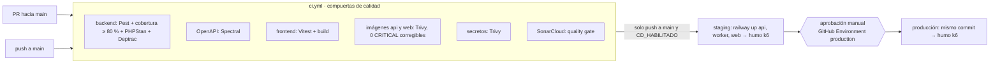

# Entrega continua: cómo está armada y cómo activarla (B2 · ADR-0020, ADR-0021 · EC-12)

## 1. El pipeline



| Archivo | Función |
|---|---|
| `.github/workflows/ci.yml` | Compuertas (ADR-0021). Corre en cada PR y, como workflow reutilizable, al inicio de `cd.yml` |
| `.github/workflows/cd.yml` | Push a `main` → compuertas → staging + humo → aprobación → producción + humo |
| `.github/workflows/reversion.yml` | Procedimiento B del runbook: redespliega un commit sano |
| `scripts/ci/railway-desplegar.sh` | `railway up --ci` y espera hasta que el despliegue **nuevo** quede en `SUCCESS` (si queda `FAILED` o `CRASHED`, falla) |
| `pruebas-calidad/k6/humo-staging.js` | Prueba de humo de solo lectura: comparación, establecimientos, canasta y PWA. Bloquea si hay cualquier error o p95 > 2 s |
| `sonar-project.properties` · `.trivyignore` | Configuración de SonarCloud; excepciones de Trivy (hoy ninguna) |

Decisiones de seguridad del propio pipeline:
- **Trivy fijado por digest** (0.69.3, publicado el 2026-03-03). En marzo de 2026 se secuestraron 76 etiquetas de `aquasecurity/trivy-action` y se publicaron binarios maliciosos de Trivy 0.69.4 a 0.69.6 (CVE-2026-33634). Por eso no se usa `trivy-action` ni ninguna etiqueta mutable.
- La acción de SonarCloud está fijada por SHA de commit (v8.4.0). k6 está fijado por digest y la CLI de Railway por versión exacta (5.71.0).
- Spectral pasó de `spectral-action@latest` a `@stoplight/spectral-cli@6.11.1`.
- Permisos mínimos (`contents: read`). Los secretos solo existen en los GitHub Environments que los necesitan.

## 2. Lo que el equipo configura una sola vez

Nada de esto va en el repositorio. Los tokens no se pegan en chats ni en issues.

### 2.1 Railway: entorno staging — ✅ creado el 2026-11-21

| Servicio | URL de staging |
|---|---|
| API | https://api-staging-19337c54.up.railway.app/v1 |
| PWA | https://web-staging-34744ef9.up.railway.app |

- Se creó con `railway environment new staging --duplicate production`, con **secretos propios**: `APP_KEY`, contraseña de PostgreSQL (cambiada también dentro de la base con `ALTER USER`) y `MODERACION_TOKEN`. Las URLs (`APP_URL`, `CORS_ALLOWED_ORIGINS`, `VITE_API_URL`) apuntan a staging. Ningún valor se imprimió ni quedó en el repositorio.
- Primer despliegue: commit `9dd9a9a`, la punta de la cadena de ramas, que incluye el módulo Comercial. Migraciones al día y semilla de demostración cargada. La prueba de humo pasó (todas las comprobaciones, p95 191 ms) y la prueba del módulo Comercial también: orden intacto, promoción aparte, 403 sobre otro establecimiento, retiro con 204.
- Pendiente: `railway config plan --environment staging` falla con el SDK `railway` 3.17.0 de `node_modules`, que pide una CLI ≥ 5.42.1 aunque la instalada es la 5.75. Hay que revisarlo antes del ensayo de reconstrucción (ADR-0020).
- Falta el token: crear un ***project token* por entorno** (Project Settings → Tokens), uno de `staging` y otro de `production`, y guardarlos en GitHub (§2.2).

Procedimiento original, por si hay que recrear staging (y nota de costo):
Duplicar api, worker, web y postgres consume crédito del plan Hobby. Si el límite de US$10 no alcanza, se aplica la contingencia de ADR-0020: staging en el servidor del equipo.
1. Crear el entorno: `railway environment new staging --duplicate production`, o desde el panel. Para recrear la topología: `railway config apply` (`.railway/railway.ts`).
2. En staging, cargar las variables de cada servicio (como en producción, con valores propios): `APP_KEY`, `DB_*`, `MODERACION_TOKEN`, y `VITE_API_URL` en `web`.
3. Generar un ***project token* por entorno** (Project Settings → Tokens): uno limitado a `staging` y otro a `production`.

### 2.2 GitHub (Settings del repositorio)

**Estado al 2026-11-21:**
- ✅ Environments `staging` y `production` creados, los dos limitados a la rama `main`.
- ✅ `production` exige la aprobación de `miguel2607` o `Sofiagiraldo01`.
- ✅ Variables `API_URL` y `WEB_URL` en los dos entornos, y `CD_HABILITADO=true` en el repositorio.
- ⏳ **Falta `RAILWAY_TOKEN` en cada entorno.** La sesión de la CLI no tiene permiso para crear tokens de proyecto (`projectTokenCreate` responde «Not Authorized»). Hay que crearlos en el panel y cargarlos sin pegarlos en ningún chat:
  ```bash
  # en una terminal propia; gh pide el valor con entrada oculta
  GH_TOKEN=$(gh auth token -u carlosaugustocue) gh secret set RAILWAY_TOKEN --env staging    --repo carlosaugustocue/proyectoNuclear4
  GH_TOKEN=$(gh auth token -u carlosaugustocue) gh secret set RAILWAY_TOKEN --env production --repo carlosaugustocue/proyectoNuclear4
  ```
- ⏳ SonarCloud (`SONAR_TOKEN`) y la regla de protección de `main`.
| Dónde | Nombre | Valor |
|---|---|---|
| Environment `staging` → Secrets | `RAILWAY_TOKEN` | project token de staging |
| Environment `staging` → Variables | `API_URL`, `WEB_URL` | URLs públicas de staging (`…/v1` y la PWA) |
| Environment `production` → Secrets | `RAILWAY_TOKEN` | project token de producción |
| Environment `production` → Variables | `API_URL`, `WEB_URL` | `https://api-production-3b3251a9.up.railway.app/v1`, `https://web-production-5b284b25.up.railway.app` |
| Environment `production` → **Required reviewers** | Miguel y Sofía (al menos 1) | Es la promoción manual |
| Repository → Secrets | `SONAR_TOKEN` | token del proyecto en SonarCloud |
| Repository → Variables | `CD_HABILITADO` | `true` cuando todo lo anterior esté listo |
| Branches → regla para `main` | Exigir PR, 1 aprobación y los checks de `ci.yml` | Así un PR en rojo no se puede fusionar (S-12) |

### 2.3 SonarCloud
1. Importar el repositorio en sonarcloud.io (organización `carlosaugustocue`). Si la clave cambia, corregir `sonar-project.properties`.
2. **Desactivar el *Automatic Analysis*** (el análisis lo hace el CI).
3. Quality gate del proyecto, sobre código nuevo: confiabilidad A, seguridad A, *hotspots* revisados al 100 %, cobertura ≥ 80 % y duplicación ≤ 3 % (ADR-0021).

## 3. Cómo se mide EC-12

| Medida | Cómo | Evidencia |
|---|---|---|
| M-18 (100 % bloqueados) | PR de prueba con una prueba rota y PR de prueba que vuelve a `nginx:1.27-alpine` → ambos en rojo y sin fusionar | Capturas en `docs/02-calidad/evidencias/b2/`. Ya hay una medición local: con `nginx:1.27-alpine`, la imagen `web` tenía 3 CVE CRITICAL corregibles (`trivy-web-nginx-1.27-antes.txt`); con `nginx:1.30-alpine` + `apk upgrade`, 0 (`trivy-web-despues.txt`) |
| M-19 (≤ 15 min) | Marca de tiempo del push frente al final del job `staging` en GitHub Actions | Captura de la ejecución |
| M-20 (0 CRITICAL corregibles y 0 secretos) | Jobs `imagenes` y `secretos` | Artefactos `trivy-api` y `trivy-web` de cada ejecución |
| M-21 (≤ 5 min) | Ensayo del runbook | Tabla del runbook |

Hallazgo HIGH abierto (no bloquea, por umbral de ADR-0021): `laravel/framework` 11.x, GHSA-5vg9-5847-vvmq (CRLF en la regla de validación `email`). Solo se corrige en Laravel 12 o 13. El proyecto no usa esa regla en ninguna validación (`grep` sobre `backend/app`), así que no es explotable aquí. Se reevalúa si se agrega registro con correo (contexto Identidad).
