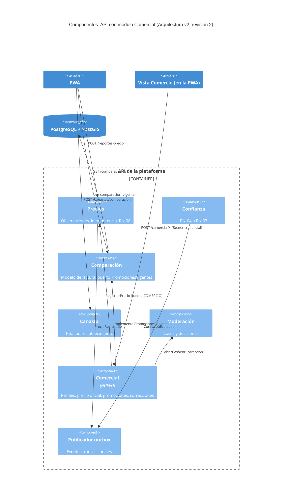
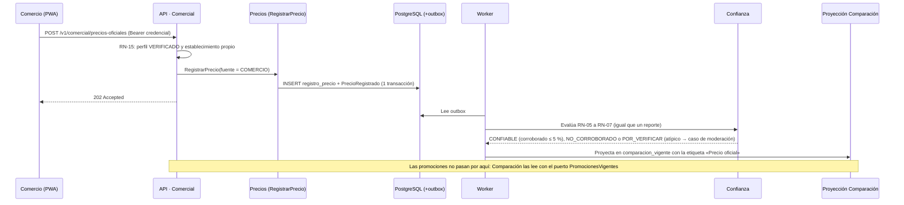

# Análisis de impacto del módulo Comercial y Arquitectura v2

> **Entregable 4 de Arquitectura de Software II (Corte 2)** · Versión original: 2026-11-11.
> **Revisión 2 · 2026-11-21: revisado tras ADR-0015 y antes de construir el módulo (corte 3).** La versión original contradecía a ADR-0015 y al código en cuatro puntos y citaba requisitos equivocados. Los cambios están listados en el §12. La estimación original del §8 **no se modificó**, porque es la línea base contra la que se mide M-08.
>
> Evalúa el impacto de incorporar el módulo Comercial sobre la arquitectura del núcleo (EC-05) y documenta los cambios necesarios sin rediseño estructural.

---

## 1. Objetivo

Demostrar que la arquitectura del núcleo (monolito modular con CQRS ligero) puede incorporar el módulo Comercial **sin cambios estructurales en los módulos existentes**, cumpliendo el escenario EC-05. El módulo abarca perfiles de establecimiento, precios oficiales, promociones y solicitudes de corrección.

> *EC-05: El módulo se agrega como contexto nuevo; el núcleo solo cambia en puntos de extensión. 0 cambios estructurales; esfuerzo real/estimado <= 1.3.*

## 2. Alcance del módulo Comercial

Según la especificación de requisitos (§4.8, agregada en esta revisión) y ADR-0014, el módulo Comercial es un **contexto delimitado propio** del que ningún contexto del núcleo depende.

| Funcionalidad | Descripción | Requisitos relacionados |
|---|---|---|
| Perfil de establecimiento | El comercio solicita un perfil vinculado a un establecimiento existente; un moderador lo verifica y se emite la credencial de comercio (ADR-0022) | RF-31, RF-24 (rol comercio), RN-15 |
| Precios oficiales | El comercio publica el precio de una presentación; entra por el mismo flujo de confianza que un reporte (ADR-0015) | RF-32, RN-05 a RN-07, EC-03 |
| Promociones | Descuento porcentual, precio especial o «pague X lleve Y», con fechas de vigencia; se muestran aparte del resultado | RF-33, RN-14, RN-16, EC-06 |
| Corrección de información | El comercio solicita corregir datos erróneos sobre su negocio; la solicitud abre un caso de moderación | RF-34 |

> La versión original citaba RF-23, RF-24 y RF-26. En la especificación, **RF-23** es el derecho del titular sobre sus datos personales, **RF-24** son los roles (incluido `comercio`) y **RF-26** es la carga semilla en CSV. Ninguno describe las funcionalidades comerciales, así que en esta revisión se crearon **RF-31 a RF-34**.

### 2.1 Restricciones de neutralidad

Según ADR-0009 (neutralidad de la comparación) y la guía del proyecto (§12):

- Un precio oficial **no tiene una posición distinta**: se ordena por el mismo criterio declarado que cualquier precio (RN-10, AR-02) y solo se distingue con la etiqueta «Precio oficial».
- Un precio oficial **no es confiable por ser oficial**: pasa por RN-05 a RN-07 (ADR-0015). Solo es `CONFIABLE` si un reporte de otro autor lo corrobora; si es atípico, queda `POR_VERIFICAR` (ver la nota de revisión de ADR-0015).
- Las promociones se muestran en un **bloque diferenciado** (`contenidoPromocional`), nunca dentro de `items` (EC-06), y no cambian el total de una canasta (ADR-0019).
- Ninguna relación comercial puede alterar el criterio de orden.

## 3. Análisis de impacto por módulo

### 3.1 Módulos que NO cambian

| Módulo | Razón por la que no cambia |
|---|---|
| **Precios** | El precio oficial se registra con el caso de uso existente `RegistrarPrecio` y `FuenteObservacion::COMERCIO`, un valor que ya existe en el enum. Comercial usa la interfaz pública de Precios; Precios no conoce a Comercial. |
| **Confianza** | Evalúa el precio oficial como cualquier observación (RN-05 a RN-07). No se agrega ningún listener ni regla. |
| **Catálogo** | El comercio referencia productos del catálogo existente; no crea productos nuevos. |
| **Establecimientos** | El perfil comercial vive en Comercial y referencia un establecimiento existente. |
| **Identidad** | Sigue diferida (ADR-0014). El comercio se autentica con la credencial de su perfil verificado (ADR-0022). |
| **Ingesta** | No cambia. |

### 3.2 Módulos que cambian en puntos de extensión previstos

| Módulo | Cambio | Tipo de cambio |
|---|---|---|
| **Comparación** | Declara la interfaz `PromocionesVigentes`, con una implementación vacía por defecto. `ConsultarComparacion` llena `contenidoPromocional`, campo reservado desde el contrato 0.2.0 que hoy viaja vacío. Las promociones **no** llegan a `OrdenComparacion` | Punto de extensión: una interfaz nueva y el llenado de un campo reservado. **No modifica** la proyección ni el orden |
| **Canasta** | Llena su `contenidoPromocional` con el mismo puerto, fuera del total (ADR-0019) | Punto de extensión |
| **Moderación** | Nuevo caso de uso público `AbrirCasoPorCorreccion`, junto a `AbrirCasoPorAnomalia` | Se agrega una clase; **no modifica** ninguna existente |

> La versión original proponía un listener en Confianza que marcaba el precio oficial como `CONFIABLE` automáticamente, una proyección nueva en Comparación y una tabla `promoción_vigente`. ADR-0015 descartó la confianza automática. ADR-0023 descarta los eventos de Comercial escuchados por el núcleo, porque obligarían a Confianza y a Comparación a importar Comercial, lo que viola AR-02.

### 3.3 Módulo nuevo: Comercial

```
app/Domains/Comercial/
  ├── Domain/
  │   ├── Entities/
  │   │   ├── PerfilComercial.php        # PENDIENTE | VERIFICADO | REVOCADO
  │   │   └── Promocion.php
  │   ├── ValueObjects/
  │   │   ├── TipoPromocion.php          # DESCUENTO_PORCENTUAL | PRECIO_ESPECIAL | PAGUE_X_LLEVE_Y
  │   │   └── VigenciaPromocion.php      # inicio, fin
  │   └── Services/
  │       ├── ValidadorPromocion.php     # RN-14 (U-14)
  │       ├── PoliticaPublicacion.php    # RN-15 (U-15)
  │       └── VisibilidadPromocion.php   # RN-16 (U-16)
  ├── Application/
  │   ├── SolicitarPerfil.php · VerificarPerfil.php · RevocarPerfil.php
  │   ├── PublicarPrecioOficial.php      # delega en Precios\RegistrarPrecio (fuente COMERCIO)
  │   ├── PublicarPromocion.php · RetirarPromocion.php
  │   └── SolicitarCorreccion.php        # delega en Moderacion\AbrirCasoPorCorreccion
  └── Infrastructure/
      ├── Persistence/ (perfiles y promociones en Eloquent)
      └── PromocionesVigentesComercial.php   # implementa el puerto de Comparación
```

### 3.4 Esquema de base de datos (migraciones nuevas)

```sql
-- Tablas del módulo Comercial (solo Comercial las lee y las escribe; AR-01)
CREATE TABLE perfiles_comerciales (
    id UUID PRIMARY KEY,
    establecimiento_id UUID NOT NULL REFERENCES establecimientos(id),
    nombre_contacto TEXT NOT NULL,        -- privado: nunca sale en respuestas públicas (EC-07)
    telefono_contacto TEXT,               -- privado
    estado VARCHAR(12) NOT NULL DEFAULT 'PENDIENTE',   -- PENDIENTE | VERIFICADO | REVOCADO
    credencial_hash CHAR(64),             -- SHA-256 de la credencial (ADR-0022); NULL hasta verificar
    verificado_en TIMESTAMPTZ,
    created_at TIMESTAMPTZ NOT NULL,
    updated_at TIMESTAMPTZ NOT NULL
);

CREATE TABLE promociones (
    id UUID PRIMARY KEY,
    perfil_comercial_id UUID NOT NULL REFERENCES perfiles_comerciales(id),
    producto_id UUID NOT NULL,
    tipo VARCHAR(30) NOT NULL,            -- DESCUENTO_PORCENTUAL | PRECIO_ESPECIAL | PAGUE_X_LLEVE_Y
    valor DECIMAL(12,2),                  -- porcentaje o precio especial
    pague SMALLINT, lleve SMALLINT,       -- solo PAGUE_X_LLEVE_Y
    inicio TIMESTAMPTZ NOT NULL,
    fin TIMESTAMPTZ NOT NULL,
    retirada_en TIMESTAMPTZ,
    created_at TIMESTAMPTZ NOT NULL
);

-- No hay tabla precios_oficiales: el precio oficial es una fila más de registros_precio
-- con fuente = 'COMERCIO' (ADR-0015).
-- No hay tabla promocion_vigente: Comparación lee las promociones con el puerto (ADR-0023).
-- La solicitud de corrección se guarda como caso de moderación (tabla existente).
```

## 4. Diagrama de integración: C4 nivel 3 actualizado



Todas las flechas que tocan a Comercial **salen** de Comercial. Ningún componente del núcleo apunta a Comercial (AR-02).

## 5. Flujo de publicación de precio oficial



## 6. Impacto en la API

| Método | Ruta | Módulo | Descripción |
|---|---|---|---|
| `POST` | `/v1/comercial/perfiles` | Comercial | Solicitar un perfil (queda `PENDIENTE`) |
| `POST` | `/v1/moderacion/perfiles/{id}/verificacion` | Comercial | El moderador verifica y recibe la credencial (se muestra una sola vez) |
| `POST` | `/v1/moderacion/perfiles/{id}/revocacion` | Comercial | El moderador revoca el perfil |
| `POST` | `/v1/comercial/precios-oficiales` | Comercial | Publicar un precio oficial |
| `POST` | `/v1/comercial/promociones` | Comercial | Publicar una promoción |
| `DELETE` | `/v1/comercial/promociones/{id}` | Comercial | Retirar una promoción |
| `POST` | `/v1/comercial/correcciones` | Comercial | Solicitar una corrección |
| `GET` | `/v1/comparaciones?productoId=` | Comparación | **Ya existe**: `contenidoPromocional` deja de viajar vacío |
| `POST` | `/v1/canastas/comparacion` | Canasta | **Ya existe** (Anexo 1): igual que la anterior |

**Cambios en endpoints existentes:** son aditivos. `contenidoPromocional` ya está en el contrato (OpenAPI 0.2.0) y ahora se llena; `items`, su orden y `criterioOrden` no cambian. La versión original citaba `GET /v1/comparaciones/{productoId}` y un campo `promociones`, pero lo implementado es `GET /v1/comparaciones?productoId=` con el campo `contenidoPromocional`.

## 7. Verificación de AR-01 y AR-02

### AR-01: Fronteras de módulo

- Comercial tiene su propio directorio, `app/Domains/Comercial/`, y sus propias tablas (`perfiles_comerciales`, `promociones`).
- Usa solo interfaces públicas: `RegistrarPrecio` (Precios), `AbrirCasoPorCorreccion` (Moderación) y el puerto `PromocionesVigentes` (Comparación).
- No lee ni escribe tablas de otros contextos.
- Deptrac lo verifica en el CI con la lista de dependencias de ADR-0023.

### AR-02: Neutralidad de la comparación

- Ningún contexto del núcleo incluye a Comercial en su lista de dependencias de Deptrac.
- Un precio oficial se ordena con el mismo `OrdenComparacion`, que no recibe ningún dato comercial.
- Las promociones solo llegan a `contenidoPromocional`. La prueba C-06 verifica que publicar una promoción no cambia `items` ni su orden, y U-11 y U-12 verifican que no cambia el total de la canasta.

## 8. Estimación de esfuerzo (EC-05: esfuerzo real/estimado <= 1.3)

### 8.1 Estimación original (2026-11-11): línea base de M-08, sin cambios

| Tarea | Estimación (horas) |
|---|---|
| Crear estructura `app/Domains/Comercial/` con entidades, VOs, eventos | 4 |
| Migraciones de BD (3 tablas) | 2 |
| Endpoints API (7 rutas) + validación | 6 |
| Listeners del worker (PrecioOficialPublicado, PromocionPublicada) | 3 |
| Extensión de la proyección de comparación (fuente_tipo + promociones) | 4 |
| Tests TDD del módulo Comercial | 6 |
| Tests de integración (endpoint → BD → worker → modelo de lectura) | 4 |
| Portal comercial Vue (dashboard, formularios) | 8 |
| **Total estimado** | **37 horas** |

### 8.2 Reestimación (2026-11-21), antes de escribir código

| Tarea | Original | Revisada | Motivo |
|---|---|---|---|
| Dominio Comercial (perfil, promoción, RN-14 a RN-16) | 4 | 5 | Tres servicios de dominio en lugar de uno |
| Migraciones | 2 | 2 | Dos tablas en lugar de tres, más la credencial |
| Endpoints y validación | 6 | 6 | Siguen siendo 7 rutas |
| Listeners del worker | 3 | 0 | El precio oficial reutiliza el flujo existente (ADR-0015) |
| Promociones en Comparación y Canasta | 4 | 3 | Puerto en lugar de proyección (ADR-0023) |
| Credencial de comercio y de moderación (ADR-0022) | — | 4 | No estaba en la estimación original |
| Corrección → Moderación | — | 2 | No estaba en la estimación original |
| Pruebas TDD (U-14 a U-16) | 6 | 6 | — |
| Pruebas de contrato e integración (C-16, C-06, I-08) | 4 | 4 | — |
| Vista Comercio en la PWA | 8 | 8 | — |
| Esta revisión documental y los ADR-0022 y ADR-0023 | — | 3 | Trabajo no previsto en el corte 2 |
| **Total** | **37** | **43** | |

**Cómo se reportará M-08:** el Entregable 6 calcula el esfuerzo real frente a **las dos** cifras. La de 37 h mide la calidad de la estimación original; la de 43 h mide la de la reestimación. Pasar de 37 a 43 h ya equivale a 1,16 sobre la línea base, antes de empezar. El equipo debe registrar sus horas reales por tarea. El uso de IA generativa se declara aparte, porque distorsiona el contraste (ver el §11).

## 9. Resumen de cambios

| Categoría | Cambios |
|---|---|
| **Módulos existentes modificados estructuralmente** | **0** (meta de EC-05; se verificará en el corte 3) |
| Cambios en puntos de extensión del núcleo | 3: interfaz `PromocionesVigentes` y llenado de `contenidoPromocional` en Comparación; ídem en Canasta; caso de uso nuevo en Moderación |
| Módulos nuevos | 1 (Comercial) |
| Tablas nuevas | 2 (`perfiles_comerciales`, `promociones`) |
| Tablas existentes modificadas | 0 |
| Endpoints nuevos | 7 |
| Endpoints existentes modificados | 2, solo de forma aditiva (`contenidoPromocional` en comparación y en canasta) |
| Pruebas existentes que deben cambiar | 0 previstas |

## 10. Conclusión

La arquitectura (monolito modular con CQRS ligero y outbox) **absorbe el módulo Comercial sin rediseño estructural**:

1. El módulo se agrega como un contexto delimitado nuevo, con su propia carpeta y sus propias tablas.
2. Se integra usando las interfaces públicas del núcleo (`RegistrarPrecio`, `AbrirCasoPorCorreccion`) e implementando el puerto que el núcleo declara (`PromocionesVigentes`). El núcleo nunca importa Comercial (ADR-0023).
3. El precio oficial no recibe privilegios: pasa por las mismas reglas de confianza (ADR-0015).
4. La neutralidad (AR-02) se mantiene por estructura (Deptrac) y por prueba (C-06): las promociones van en un bloque separado y no tocan ni el orden ni el total.
5. Las pruebas existentes no deberían requerir cambios. Eran 153 al cierre del corte 2 y son 192 con la canasta del Anexo 1. La versión original decía «77 tests».

Esto confirma la decisión de ADR-0002 (monolito modular): la **modificabilidad no requiere microservicios**, solo fronteras de módulo claras e inversión de dependencias donde el núcleo necesita datos de un módulo periférico.

## 11. Declaración de uso de inteligencia artificial generativa

Conforme a la guía del proyecto (§12.5), el equipo declara que utilizó el asistente de IA generativa **Claude (Anthropic)** como apoyo en las siguientes actividades:

| Actividad | Uso de la IA | Revisión del equipo |
|---|---|---|
| Estructura del análisis de impacto | Formato de secciones y tablas | El equipo definió el alcance del módulo y las restricciones de neutralidad |
| Diagramas Mermaid (C4 v2, secuencia) | Generación de sintaxis a partir de decisiones del equipo | Verificación de fidelidad con la arquitectura |
| Estimación de esfuerzo | Formato; las horas son estimaciones del equipo | Revisión de razonabilidad |
| Esquema SQL del módulo Comercial | Borrador de tablas basado en las entidades definidas por el equipo | Verificación de consistencia con el esquema existente |
| Revisión 2 (2026-11-21) | Detección de contradicciones con ADR-0015 y el código; borrador de las correcciones, de ADR-0022 y ADR-0023 y de la reestimación | Pendiente: el equipo debe revisar y aprobar los ADR propuestos y la reestimación |

**Compromisos del equipo:** el análisis de impacto se basa en la arquitectura documentada y en las decisiones registradas en los ADRs. Cada integrante puede explicar cómo el módulo Comercial se integra sin violar las fronteras de módulo (AR-01) ni la neutralidad (AR-02).

## 12. Registro de cambios de la revisión 2 (2026-11-21)

| # | Sección | Decía (versión 2026-11-11) | Dice ahora | Fuente |
|---|---|---|---|---|
| 1 | §2.1, §3.2, §5 | Confianza marca el precio oficial como `CONFIABLE` automáticamente | El precio oficial pasa por RN-05 a RN-07: `CONFIABLE` si se corrobora, `NO_CORROBORADO` si no, `POR_VERIFICAR` si es atípico | ADR-0015 (nota de revisión) y prueba I-08 |
| 2 | §6 | `GET /v1/comparaciones/{productoId}` con un campo `promociones` | `GET /v1/comparaciones?productoId=` con `contenidoPromocional` | Código y OpenAPI 0.2.0 |
| 3 | §3.2, §3.4, §7, §9 | Tabla de lectura `promoción_vigente` y tabla `precios_oficiales` | Puerto `PromocionesVigentes`; el precio oficial es una fila de `registros_precio` | ADR-0015, ADR-0023 |
| 4 | §2 | RF-23, RF-24 y RF-26 como requisitos comerciales | RF-31 a RF-34 (nuevos); RF-24 solo para el rol | Especificación de requisitos |
| 5 | §3.1, §3.3, §4 | Eventos `PrecioOficialPublicado` y `PromocionPublicada` escuchados por el núcleo; eventos `PrecioReportado` en el diagrama | Sin eventos nuevos; el evento real es `PrecioRegistrado` | ADR-0023 y código |
| 6 | §3.1 | Identidad agrega el rol `comercio` | Identidad sigue diferida; credencial de perfil verificado | ADR-0014, ADR-0022 |
| 7 | §10 | «77 tests» | 153 al cierre del corte 2; 192 con la canasta | Ejecución de la suite |
| 8 | §8 | Solo la estimación original | Estimación original intacta y reestimación al lado | Necesario para M-08 |
