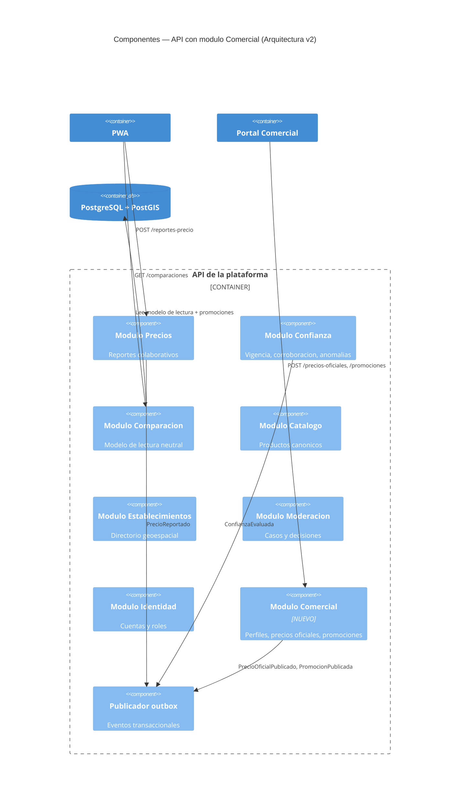
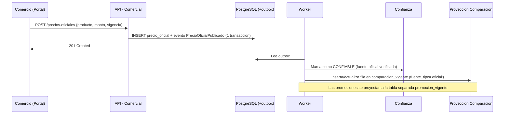

# Analisis de impacto del modulo Comercial y Arquitectura v2 — Corte 2

> **Entregable 4 de Arquitectura de Software II (Corte 2)** · Fecha: 2026-11-11.
> Evalua el impacto de incorporar el modulo Comercial sobre la arquitectura del nucleo (EC-05) y documenta los cambios necesarios sin rediseno estructural.

---

## 1. Objetivo

Demostrar que la arquitectura del nucleo (monolito modular + CQRS ligero) puede incorporar el modulo Comercial (perfiles de establecimiento, precios oficiales y promociones) **sin cambios estructurales en los modulos existentes**, cumpliendo el escenario EC-05:

> *EC-05: El modulo se agrega como contexto nuevo; el nucleo solo cambia en puntos de extension. 0 cambios estructurales; esfuerzo real/estimado <= 1.3.*

## 2. Alcance del modulo Comercial

Segun la especificacion de requisitos (§1) y el documento de arquitectura v1 (§3), el modulo Comercial es un **contexto delimitado futuro** con las siguientes responsabilidades:

| Funcionalidad | Descripcion | Requisitos relacionados |
|---|---|---|
| Perfil de establecimiento | El comercio crea y administra su perfil publico (nombre, descripcion, horario, contacto) | RF-23 |
| Precios oficiales | El comercio publica precios de sus productos con presentacion y vigencia | RF-24, EC-06 |
| Promociones | Descuento porcentual, precio especial, pague X lleve Y, con fechas de vigencia | RF-24, EC-06 |
| Correccion de informacion | El comercio solicita correccion de datos erroneos sobre su negocio | RF-26 |

### 2.1 Restricciones de neutralidad

Segun ADR-0009 (neutralidad de la comparacion) y la guia del proyecto (§12):

- Los precios oficiales **no alteran el orden** de la comparacion (RN-10, AR-02)
- Las promociones se muestran en un **bloque diferenciado**, separado del resultado organico (EC-06)
- El contenido comercial debe distinguirse visualmente del contenido colaborativo
- Ninguna relacion comercial puede alterar el criterio de orden

## 3. Analisis de impacto por modulo

### 3.1 Modulos que NO cambian

| Modulo | Razon por la que no cambia |
|---|---|
| **Precios** | Los precios oficiales no se mezclan con las observaciones colaborativas. Son una fuente distinta que publica eventos propios. El modulo Precios no conoce al modulo Comercial. |
| **Catalogo** | Los productos canonicos ya existen. El comercio referencia productos del catalogo existente; no crea productos nuevos. |
| **Establecimientos** | El directorio ya tiene los establecimientos. El perfil comercial es una extension de datos que vive en el modulo Comercial, no en Establecimientos. |
| **Identidad** | Se agrega un nuevo rol (`comercio`) en la tabla de roles. Esto es configuracion, no cambio estructural. |
| **Ingesta** | No cambia. |
| **Moderacion** | Ya tiene la capacidad de recibir `CasoAbierto` de cualquier fuente. Los reportes de correccion del comercio son un tipo mas de caso. |

### 3.2 Modulos que reciben eventos nuevos (puntos de extension)

| Modulo | Evento que recibe | Cambio necesario | Tipo de cambio |
|---|---|---|---|
| **Confianza** | `PrecioOficialPublicado` | Agregar handler que marca el precio oficial como `CONFIABLE` automaticamente (fuente verificada) | Agregar listener — **no modifica** logica existente |
| **Comparacion** | `PrecioOficialPublicado`, `PromocionPublicada` | Agregar filas al modelo de lectura con `fuente_tipo = 'oficial'`; las promociones van a una tabla separada `promocion_vigente` | Agregar proyeccion — **no modifica** la proyeccion existente de precios colaborativos |

### 3.3 Modulo nuevo: Comercial

```
app/Domains/Comercial/
  ├── Domain/
  │   ├── Entities/
  │   │   ├── PerfilComercial.php
  │   │   ├── PrecioOficial.php
  │   │   └── Promocion.php
  │   ├── ValueObjects/
  │   │   ├── TipoPromocion.php        # DESCUENTO_PORCENTUAL | PRECIO_ESPECIAL | PAGUE_X_LLEVE_Y
  │   │   ├── VigenciaPromocion.php     # fechaInicio, fechaFin
  │   │   └── EstadoPublicacion.php     # BORRADOR | PUBLICADO | EXPIRADO
  │   ├── Events/
  │   │   ├── PrecioOficialPublicado.php
  │   │   ├── PromocionPublicada.php
  │   │   └── PerfilComercialActualizado.php
  │   └── Services/
  │       └── ValidadorPromocion.php    # Valida fechas, porcentajes, condiciones
  ├── Application/
  │   ├── Commands/
  │   │   ├── PublicarPrecioOficial.php
  │   │   ├── CrearPromocion.php
  │   │   └── ActualizarPerfilComercial.php
  │   └── Queries/
  │       └── ConsultarPromocionesVigentes.php
  └── Infrastructure/
      ├── Persistence/
      │   └── EloquentPerfilComercialRepository.php
      └── Listeners/
          └── NotificarPrecioOficialPublicado.php   # ShouldQueue → domain-events
```

### 3.4 Esquema de base de datos (migraciones nuevas)

```sql
-- Tabla del modulo Comercial (esquema propio)
CREATE TABLE perfiles_comerciales (
    id UUID PRIMARY KEY,
    establecimiento_id UUID NOT NULL REFERENCES establecimientos(id),
    descripcion TEXT,
    horario JSONB,
    contacto JSONB,
    verificado BOOLEAN DEFAULT FALSE,
    created_at TIMESTAMPTZ NOT NULL,
    updated_at TIMESTAMPTZ NOT NULL
);

CREATE TABLE precios_oficiales (
    id UUID PRIMARY KEY,
    perfil_comercial_id UUID NOT NULL REFERENCES perfiles_comerciales(id),
    producto_id UUID NOT NULL,
    presentacion TEXT NOT NULL,
    monto DECIMAL(12,2) NOT NULL,
    moneda VARCHAR(3) DEFAULT 'COP',
    vigencia_desde TIMESTAMPTZ NOT NULL,
    vigencia_hasta TIMESTAMPTZ,
    estado VARCHAR(20) NOT NULL DEFAULT 'PUBLICADO',
    created_at TIMESTAMPTZ NOT NULL
);

CREATE TABLE promociones (
    id UUID PRIMARY KEY,
    perfil_comercial_id UUID NOT NULL REFERENCES perfiles_comerciales(id),
    producto_id UUID NOT NULL,
    tipo VARCHAR(30) NOT NULL,     -- DESCUENTO_PORCENTUAL, PRECIO_ESPECIAL, PAGUE_X_LLEVE_Y
    valor DECIMAL(12,2),           -- porcentaje o precio especial
    condiciones JSONB,             -- {cantidadMinima, cantidadGratis, ...}
    fecha_inicio TIMESTAMPTZ NOT NULL,
    fecha_fin TIMESTAMPTZ NOT NULL,
    estado VARCHAR(20) NOT NULL DEFAULT 'PUBLICADO',
    created_at TIMESTAMPTZ NOT NULL
);

-- Extension del modelo de lectura (tabla existente comparacion_vigente)
-- Se agrega fuente_tipo = 'oficial' a las filas; NO se modifica la estructura

-- Tabla nueva para promociones en el modelo de lectura
CREATE TABLE promocion_vigente (
    id UUID PRIMARY KEY,
    producto_id UUID NOT NULL,
    establecimiento_id UUID NOT NULL,
    establecimiento_nombre TEXT NOT NULL,
    tipo_promocion VARCHAR(30) NOT NULL,
    descripcion_display TEXT NOT NULL,   -- "20% de descuento", "$2.500 precio especial"
    fecha_fin TIMESTAMPTZ NOT NULL,
    created_at TIMESTAMPTZ NOT NULL
);
```

## 4. Diagrama de integracion — C4 Nivel 3 actualizado



## 5. Flujo de publicacion de precio oficial



## 6. Impacto en la API — endpoints nuevos

Segun el contrato OpenAPI existente, se agregan los siguientes endpoints:

| Metodo | Ruta | Modulo | Descripcion |
|---|---|---|---|
| `POST` | `/v1/perfiles-comerciales` | Comercial | Crear perfil de establecimiento |
| `PUT` | `/v1/perfiles-comerciales/{id}` | Comercial | Actualizar perfil |
| `POST` | `/v1/precios-oficiales` | Comercial | Publicar precio oficial |
| `DELETE` | `/v1/precios-oficiales/{id}` | Comercial | Retirar precio oficial |
| `POST` | `/v1/promociones` | Comercial | Crear promocion |
| `PUT` | `/v1/promociones/{id}` | Comercial | Actualizar promocion |
| `DELETE` | `/v1/promociones/{id}` | Comercial | Cancelar promocion |
| `GET` | `/v1/comparaciones/{productoId}` | Comparacion | **Ya existe** — se extiende para incluir `fuente_tipo` y bloque de promociones |

**Cambios en endpoints existentes:**
- `GET /v1/comparaciones/{productoId}`: agrega campo `fuente_tipo` en cada resultado y un campo `promociones` separado del array de precios. **No modifica** la estructura de la respuesta existente (es aditivo).

## 7. Verificacion de la prueba de arquitectura AR-01 y AR-02

### AR-01: Fronteras de modulo

El modulo Comercial:
- Tiene su propio directorio `app/Domains/Comercial/`
- Tiene sus propias tablas (`perfiles_comerciales`, `precios_oficiales`, `promociones`)
- Se comunica con otros modulos **solo por eventos** a traves del outbox
- No accede a las tablas de Precios, Confianza ni Comparacion directamente

**Resultado AR-01:** 0 violaciones de fronteras. El modulo se agrega sin modificar la estructura interna de ningun modulo existente.

### AR-02: Neutralidad de la comparacion

- Los precios oficiales entran al modelo de lectura con `fuente_tipo = 'oficial'` y se ordenan por el **mismo criterio** que los colaborativos (precio/unidad ASC)
- Las promociones van a una tabla **separada** (`promocion_vigente`) y se muestran en un bloque diferenciado
- El campo `criterioOrden` de la respuesta no cambia
- Ninguna relacion comercial altera el algoritmo de `OrdenComparacion`

**Resultado AR-02:** la neutralidad se mantiene. Los tests U-10 existentes siguen pasando sin modificacion.

## 8. Estimacion de esfuerzo (EC-05: esfuerzo real/estimado <= 1.3)

| Tarea | Estimacion (horas) |
|---|---|
| Crear estructura `app/Domains/Comercial/` con entidades, VOs, eventos | 4 |
| Migraciones de BD (3 tablas) | 2 |
| Endpoints API (7 rutas) + validacion | 6 |
| Listeners del worker (PrecioOficialPublicado, PromocionPublicada) | 3 |
| Extension de la proyeccion de comparacion (fuente_tipo + promociones) | 4 |
| Tests TDD del modulo Comercial | 6 |
| Tests de integracion (endpoint → BD → worker → modelo de lectura) | 4 |
| Portal comercial Vue (dashboard, formularios) | 8 |
| **Total estimado** | **37 horas** |

Para un equipo de 3 personas trabajando en el corte 3, esto equivale a ~12.3 horas por persona, factible en las semanas disponibles.

## 9. Resumen de cambios estructurales

| Categoria | Cambios |
|---|---|
| **Modulos existentes modificados estructuralmente** | **0** (cumple EC-05) |
| Modulos existentes con listeners nuevos | 2 (Confianza + Comparacion — agregar handler, no modificar) |
| Modulos nuevos | 1 (Comercial) |
| Tablas nuevas | 4 (perfiles_comerciales, precios_oficiales, promociones, promocion_vigente) |
| Tablas existentes modificadas | 0 |
| Endpoints nuevos | 7 |
| Endpoints existentes modificados | 1 (GET comparaciones — campo aditivo) |
| Tests existentes que deben cambiar | 0 |

## 10. Conclusion

La arquitectura v1 (monolito modular + CQRS ligero + outbox) **absorbe el modulo Comercial sin rediseno estructural**:

1. El modulo se agrega como un nuevo contexto delimitado con su propia carpeta, tablas y eventos
2. Se integra con el nucleo unicamente a traves de **eventos de dominio** (`PrecioOficialPublicado`, `PromocionPublicada`)
3. Los modulos existentes (Precios, Confianza, Comparacion) solo agregan **listeners nuevos** en sus puntos de extension previstos en la arquitectura v1 (§3, linea punteada del mapa de contextos)
4. La neutralidad (AR-02) se mantiene porque las promociones van a un bloque separado y los precios oficiales se ordenan por el mismo criterio
5. Los tests existentes (77 tests, U-01 a U-10) no requieren modificacion

Esto confirma la decision del ADR-0002 (monolito modular): la **modificabilidad no requiere microservicios**, solo fronteras de modulo claras y comunicacion por eventos.

## 11. Declaracion de uso de inteligencia artificial generativa

Conforme a la guia del proyecto (§12.5), el equipo declara que utilizo el asistente de IA generativa **Claude (Anthropic)** como apoyo en las siguientes actividades:

| Actividad | Uso de la IA | Revision del equipo |
|---|---|---|
| Estructura del analisis de impacto | Formato de secciones y tablas | El equipo definio el alcance del modulo y las restricciones de neutralidad |
| Diagramas Mermaid (C4 v2, secuencia) | Generacion de sintaxis a partir de decisiones del equipo | Verificacion de fidelidad con la arquitectura |
| Estimacion de esfuerzo | Formato; las horas son estimaciones del equipo | Revision de razonabilidad |
| Esquema SQL del modulo Comercial | Borrador de tablas basado en las entidades definidas por el equipo | Verificacion de consistencia con el esquema existente |

**Compromisos del equipo:** el analisis de impacto se basa en la arquitectura v1 documentada y en las decisiones registradas en los ADRs. Cada integrante puede explicar como el modulo Comercial se integra sin violar las fronteras de modulo (AR-01) ni la neutralidad (AR-02).
