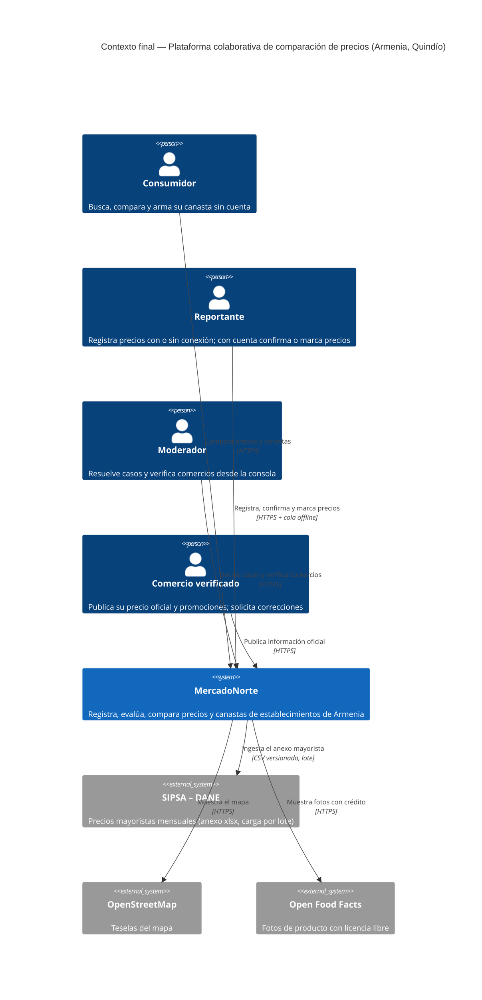
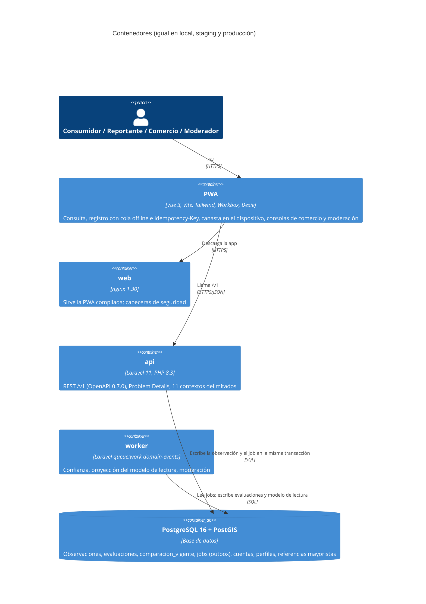
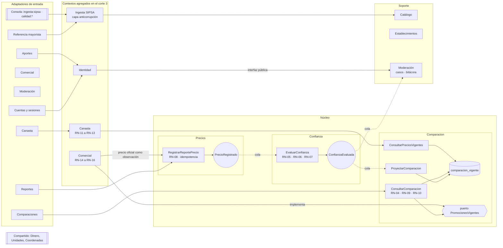
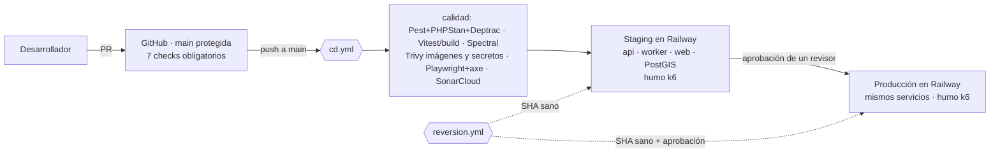

# Documento de arquitectura final (v3) — Sistema integrado

> Corte 3 · Arquitectura de Software II · Entregable 6 (documento final). Fecha: 2026-11-25.
> Describe el sistema **tal como está construido y desplegado** al cierre: núcleo, módulo Comercial, ampliación
> del Anexo 1 (A1 canasta comparada y B2 entrega continua), Identidad, Moderación e Ingesta de SIPSA.
> Lo que no cambia se cita sin repetirlo: contexto del problema y escenarios en la
> [v1](documento-arquitectura-v1.md) §1–§2; evolución del corte 2 en la [v2](documento-arquitectura-v2.md) §1.
> La evaluación de esta arquitectura está en [evaluacion-arquitectura.md](evaluacion-arquitectura.md).

## 1. Qué cambió desde la v2

| # | Cambio | Motivo | Decisión |
|---|---|---|---|
| 1 | Contexto **Comercial**: perfil verificado, precio oficial y promociones | Requerimiento de cambio de la guía (Fase 4) | [ADR-0014](adr/0014-contexto-comercial-e-identidad-diferida.md), [0015](adr/0015-precio-oficial-frente-a-precio-reportado.md), [0022](adr/0022-comercial-perfil-verificado-y-credencial-de-comercio.md), [0023](adr/0023-comercial-integracion-con-el-nucleo-por-puertos.md) |
| 2 | El precio oficial es una **observación más** (fuente `COMERCIO`) que pasa por Confianza; no hay listener ni proyección propios | No duplicar el flujo y no dar trato preferente (neutralidad) | ADR-0015 |
| 3 | Las promociones llegan a Comparación por un **puerto** (`PromocionesVigentes`) que implementa Comercial; Comparación nunca depende de Comercial | AR-02 y EC-06 | ADR-0023 |
| 4 | Contexto **Canasta** (A1): calcula en consulta sobre la interfaz pública de Comparación; la canasta vive en el dispositivo | Actualidad del dato y privacidad | [ADR-0017](adr/0017-canasta-contexto-nuevo-calculo-en-consulta.md), [0018](adr/0018-canasta-sin-persistencia-en-servidor.md), [0019](adr/0019-canasta-faltantes-orden-y-promociones.md) |
| 5 | **Entrega continua** (B2): CI reutilizable, Trivy, SonarCloud, staging con humo k6, producción con aprobación y reversión | Anexo 1, bloque B | [ADR-0020](adr/0020-entrega-continua-staging-produccion-railway.md), [0021](adr/0021-quality-gate-sonarcloud-y-escaneo-trivy.md) |
| 6 | Contexto **Identidad**: cuentas con consentimiento (Ley 1581), sesiones con token opaco y moderadores con cuenta; reemplaza el seudónimo por IP | Riesgo de la v2 (redes compartidas) | [ADR-0025](adr/0025-identidad-cuentas-sesiones-y-moderadores.md) |
| 7 | Aportes con cuenta: «sigue igual» (confirmación), «marcar como dudoso» y «mis aportes» | RF-10, RF-12, RF-19 | [ADR-0026](adr/0026-aportes-con-cuenta-confirmar-marcar-mis-aportes.md) |
| 8 | **Moderación** con consola: cola de casos, decisiones con bitácora y verificación de comercios | Cerrar el ciclo de EC-03 | ADR-0022, ADR-0025 |
| 9 | Seguridad transversal: IP real tras el proxy, cabeceras y límite por IP | Hallazgo en producción (todas las peticiones parecían venir de la misma IP) | [ADR-0024](adr/0024-seguridad-transversal-proxy-cabeceras-y-limites.md) |
| 10 | **Ingesta SIPSA-DANE** con capa anticorrupción: catálogo real de Armenia (115 productos del anexo: 114 nuevos y 1 que ya existía; el catálogo pasó de 12 a 126) y referencia mayorista **aparte** de la comparación | RF-25, RF-26 | [ADR-0010](adr/0010-datos-iniciales.md) (implementado; sigue Propuesto hasta el recorrido de campo) |
| 11 | Sesiones de Laravel en memoria (`array`): la tabla `sessions` guardaba IP y *user agent* | Auditoría D-06 (ISO/IEC 25012, confidencialidad) | R-01; nota en ADR-0025 |

## 2. C4 nivel 1 — Contexto

## 3. C4 nivel 2 — Contenedores

## 4. C4 nivel 3 — Componentes de la API

**Fronteras que Deptrac verifica en cada PR** (`backend/deptrac.yaml`, 0 violaciones):

| Contexto | Puede depender de | Nota |
|---|---|---|
| Compartido | — | Núcleo compartido mínimo |
| Catálogo, Establecimientos | Compartido | Soporte |
| Precios | Compartido, Catálogo | |
| Confianza | Compartido, Precios | |
| Comparación | Compartido, Confianza, Catálogo, Establecimientos | **No** Comercial (AR-02) |
| Moderación | Compartido, Confianza | |
| Canasta | Compartido, Comparación | Solo la interfaz pública; **no** Comercial (AR-02) |
| Comercial | Compartido, Catálogo, Establecimientos, Precios, Comparación, Moderación | Nadie del núcleo depende de él |
| Identidad | Compartido, Precios, Moderación | Nadie del núcleo depende de él |
| Ingesta | Compartido, Catálogo, Establecimientos, Precios | Escribe el catálogo por el puerto `CatalogoEscritura` |

## 5. Flujos principales

1. **Registro (EC-01, EC-09):** la PWA guarda el reporte en IndexedDB con una `Idempotency-Key`; lo envía o
   lo reintenta con espera exponencial al volver la red. La API aplica RN-08 y guarda observación + job en una
   transacción (outbox) y responde `202`.
2. **Confianza (EC-03):** el worker evalúa anomalía (MAD, n ≥ 5; si no, historial ±50 %), corroboración (dos
   reportantes distintos, ±5 %, 48 h) y reputación; publica `ConfianzaEvaluada`. Si queda POR_VERIFICAR,
   Moderación abre un caso.
3. **Comparación (EC-02, EC-04, EC-06):** la proyección actualiza `comparacion_vigente`; la consulta aplica
   vigencia (RN-04), orden declarado (RN-10) y añade las promociones **en un bloque aparte**.
4. **Precio oficial (ADR-0015):** el comercio verificado publica; entra como observación `COMERCIO` y sigue el
   mismo flujo. No salta la corroboración ni cambia el orden.
5. **Canasta (EC-11):** hasta 20 productos; total por establecimiento con faltantes señalados y no sumados
   (M-17), en una sola consulta al modelo de lectura.
6. **Referencia mayorista (RF-25):** `ingesta:sipsa` (idempotente) carga el anexo del DANE; la PWA la muestra
   debajo de la comparación con el rótulo «No entra en la comparación de tiendas».

## 6. Vista de despliegue

| Entorno | Cómo | Estado al 2026-11-25 |
|---|---|---|
| Local | `docker compose up -d` (api, worker, nginx, postgis, pwa) | Funciona |
| e2e | `docker-compose.e2e.yml`: las **mismas imágenes de Railway** + Playwright y axe | 17/17 en el CI |
| Staging | Railway, proyecto `precios-armenia`, entorno `staging`; despliegue automático tras el CI | Al día con `main` (126 productos) |
| Producción | Railway, entorno `production`; promoción manual con aprobación de miguel2607 o Sofiagiraldo01 | En línea; la última promoción (#25, catálogo SIPSA) espera aprobación |
| Topología como código | `.railway/railway.ts` (servicios, variables no secretas, healthchecks) | ADR-0020 |

## 7. Registro completo de ADRs

| ADR | Decisión | Estado |
|---|---|---|
| [0001](adr/0001-registrar-decisiones.md) | Registrar decisiones con ADRs | Aceptado |
| [0002](adr/0002-monolito-modular.md) | Monolito modular por contextos delimitados | Aceptado |
| [0003](adr/0003-cqrs-ligero-outbox.md) | CQRS ligero con modelo de lectura y outbox | Aceptado |
| [0004](adr/0004-api-rest-openapi.md) | REST con OpenAPI 3.1 (GraphQL, gRPC y WebSockets descartados) | Aceptado |
| [0005](adr/0005-postgresql-postgis.md) | PostgreSQL + PostGIS | Aceptado |
| [0006](adr/0006-pwa-offline-first.md) | PWA offline-first | Aceptado |
| [0007](adr/0007-modelo-confianza.md) | Modelo de confianza de precios | Propuesto (umbrales sin evidencia de campo) |
| [0008](adr/0008-identidad-producto.md) | Identidad de producto y normalización | Aceptado |
| [0009](adr/0009-neutralidad-comparacion.md) | Neutralidad de la comparación | Aceptado |
| [0010](adr/0010-datos-iniciales.md) | Datos iniciales: semilla + SIPSA (implementado) | Propuesto (falta el recorrido de campo) |
| [0011](adr/0011-despliegue-contenedores.md) | Despliegue reproducible con contenedores | Aceptado |
| [0012](adr/0012-stack-tecnologico.md) | Stack: Laravel 11, Vue 3, PostgreSQL 16, Pest, Deptrac, PHPStan | Aceptado |
| [0013](adr/0013-well-architected-framework-despliegue.md) | AWS WAF como marco; Railway como proveedor | Aceptado |
| [0014](adr/0014-contexto-comercial-e-identidad-diferida.md) | Contexto Comercial e Identidad diferida | Propuesto |
| [0015](adr/0015-precio-oficial-frente-a-precio-reportado.md) | El precio oficial es una observación más | Propuesto |
| [0016](adr/0016-nucleo-compartido-y-fronteras-por-contexto.md) | Núcleo compartido y fronteras por contexto | Aceptado |
| [0017](adr/0017-canasta-contexto-nuevo-calculo-en-consulta.md) | Canasta: contexto nuevo, cálculo en consulta | Aceptado |
| [0018](adr/0018-canasta-sin-persistencia-en-servidor.md) | Canasta sin persistencia en el servidor | Aceptado |
| [0019](adr/0019-canasta-faltantes-orden-y-promociones.md) | Canasta: faltantes, orden y promociones | Aceptado |
| [0020](adr/0020-entrega-continua-staging-produccion-railway.md) | Entrega continua: staging y producción en Railway | Aceptado |
| [0021](adr/0021-quality-gate-sonarcloud-y-escaneo-trivy.md) | Quality gate SonarCloud y escaneo Trivy | Aceptado |
| [0022](adr/0022-comercial-perfil-verificado-y-credencial-de-comercio.md) | Comercial: perfil verificado y credencial de comercio | Propuesto |
| [0023](adr/0023-comercial-integracion-con-el-nucleo-por-puertos.md) | Comercial: integración con el núcleo por puertos | Propuesto |
| [0024](adr/0024-seguridad-transversal-proxy-cabeceras-y-limites.md) | Seguridad: proxy, cabeceras y límites | Propuesto |
| [0025](adr/0025-identidad-cuentas-sesiones-y-moderadores.md) | Identidad: cuentas, sesiones y moderadores | Propuesto |
| [0026](adr/0026-aportes-con-cuenta-confirmar-marcar-mis-aportes.md) | Aportes con cuenta: confirmar, marcar, mis aportes | Propuesto |

**Ninguna decisión se reemplazó ni se deprecó.** Nueve ADRs siguen en Propuesto: dos (0007, 0010) por falta de
evidencia de campo y siete (0014, 0015, 0022 a 0026) porque esperan la revisión del equipo. Pasarlos a Aceptado,
o registrar por qué no, es una tarea del equipo antes de la sustentación.

## 8. Riesgos vigentes

| Riesgo | Efecto | Mitigación / estado |
|---|---|---|
| Servidor de aplicaciones `artisan serve` en producción | EC-04 no se cumple con 500 usuarios (ver la evaluación) | Cambiar a php-fpm + nginx o FrankenPHP; medir de nuevo K-01 |
| Umbrales ⚑ sin evidencia de campo | Vigencia, detección y reputación podrían no ajustarse | ADR-0007 en Propuesto; recalibrar con datos reales |
| Producción depende de la aprobación manual de dos personas | Una promoción puede quedar días en espera (ya ocurre con #25) | Turnos de aprobación; aviso automático al equipo |
| Plan Hobby de Railway (US$10 de límite) | Corte del servicio si se excede | Límite duro configurado; borrar el proyecto tras la sustentación |

## 9. Declaración de uso de inteligencia artificial generativa

Este documento y el código que describe se elaboraron con apoyo de Claude (Anthropic) como asistente de
programación y redacción. Las decisiones están en los ADR citados; el equipo debe revisarlas, poder
explicarlas y defenderlas en la sustentación (guía §12.5).
