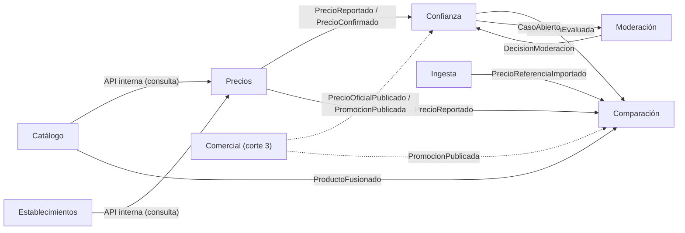
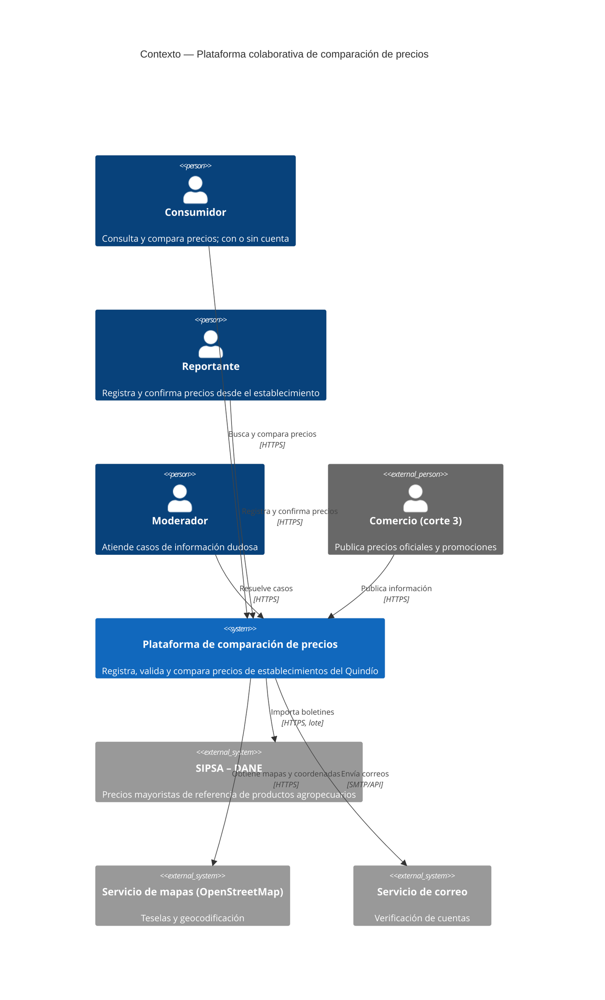
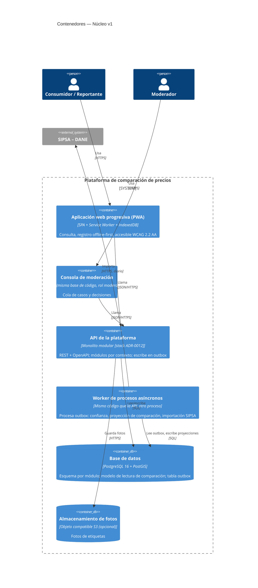
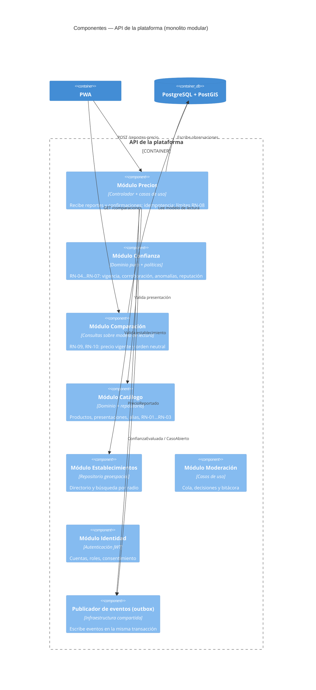
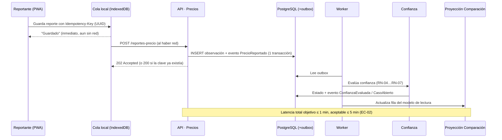

# Documento de arquitectura v1 — Núcleo

> **Entregable 1 de Arquitectura de Software II (Corte 1)** · Estado: borrador 30/10/2026.
> Insumos: [especificación de requisitos](../01-requisitos/especificacion-requisitos.md) · Decisiones: [ADRs](adr/) · Contrato: [openapi.yaml](api/openapi.yaml)

## 1. Contexto del problema

En Armenia y el Quindío, un mismo producto tiene precios distintos según el establecimiento, y la información está dispersa. La plataforma permite que los usuarios registren precios observados y que cualquiera los compare. El problema técnico de fondo es presentar como **confiable, actualizada y neutral** información que llega de fuentes con distinta confiabilidad e intereses.

Características del problema que **determinan la arquitectura**:

1. **Asimetría lectura/escritura:** las consultas superan ampliamente a los registros; los picos se concentran en fines de semana de quincena.
2. **Datos de credibilidad variable** que pierden vigencia con el tiempo.
3. **Captura en campo** con conectividad móvil limitada.
4. **Evolución anunciada:** el módulo comercial llega sobre el núcleo construido (EC-05).
5. **Equipo pequeño (3) y un semestre:** la complejidad operacional cuesta caro.

## 2. Escenarios que guían la arquitectura

De la priorización por árbol de utilidad (especificación, §8.1):

| Prioridad | Escenario | Implicación de diseño |
|---|---|---|
| 1 | EC-03 Credibilidad / reportes falsos | Un módulo de **confianza** explícito, separado del registro, con reglas probables por TDD y trazabilidad |
| 2 | EC-05 Modificabilidad | Límites de módulo claros (contextos DDD) y comunicación por eventos de dominio |
| 3 | EC-09 Registro sin conexión | Cliente *offline-first* con cola local y API idempotente |
| 4 | EC-04 Desempeño en consultas | Modelo de lectura precalculado y separado del de escritura |
| 5 | EC-02 Actualidad | Proyección asíncrona con latencia acotada (≤ 5 min) |
| 6 | EC-01 Registro en ≤ 15 s | Flujo mínimo, sugerencias por ubicación, confirmación "sigue igual" |

## 3. Descomposición del dominio (DDD)

| Contexto delimitado | Responsabilidad | Tipo |
|---|---|---|
| **Catálogo** | Productos canónicos, presentaciones, alias, EAN, normalización por unidad | Soporte |
| **Establecimientos** | Directorio, tipo, ubicación geográfica | Soporte |
| **Precios** | Recibir observaciones de precio (reportes, confirmaciones), límites de aporte | Núcleo |
| **Confianza** | Estado de confianza, detección de anomalías, reputación, corroboración | **Núcleo diferenciador** |
| **Comparación** | Modelo de lectura y consultas de comparación; orden neutral | Núcleo |
| **Moderación** | Casos, decisiones, bitácora | Soporte |
| **Identidad** | Cuentas, roles, autorización de datos personales | Genérico |
| **Ingesta** | Carga semilla y SIPSA | Genérico |
| *Comercial (corte 2–3)* | *Perfiles, precios oficiales, promociones* | *Núcleo (futuro)* |

**Mapa de contextos (relaciones):**



La línea punteada muestra el **punto de extensión** previsto: el módulo comercial se integra **publicando eventos** que Confianza y Comparación ya saben consumir (como una fuente de observaciones más), sin que el núcleo dependa de él.

## 4. Alternativas candidatas

### Alternativa A — Monolito modular con CQRS ligero

Una sola unidad desplegable (API + *worker*) organizada en módulos por contexto delimitado, con fronteras forzadas por pruebas de arquitectura. Cada módulo es dueño de su esquema en una misma base PostgreSQL. Los módulos se comunican por **eventos de dominio** a través de una tabla *outbox* transaccional que procesa un *worker*. La comparación se sirve desde un **modelo de lectura** desnormalizado que el *worker* proyecta.

### Alternativa B — Microservicios con bus de eventos

Un servicio por contexto (Catálogo, Establecimientos, Precios, Confianza, Comparación, Identidad), cada uno con su base de datos; *API Gateway*; comunicación asíncrona mediante un *broker* (RabbitMQ/Kafka); orquestación con Kubernetes.

### Alternativa C — Backend como servicio (BaaS) *(considerada brevemente)*

Supabase/Firebase con reglas de seguridad y funciones en la nube; casi sin backend propio.

### 4.1 Comparación frente a los escenarios

Escala: ++ = 2, + = 1, 0 = 0, − = −1, −− = −2; se multiplica por el peso del criterio.

| Criterio (peso) | A. Monolito modular + CQRS ligero | B. Microservicios | C. BaaS |
|---|---|---|---|
| EC-03 Credibilidad (3) | **+** reglas de confianza en un módulo, transacciones locales, fácil de probar | + aislado, pero la consistencia entre servicios complica la corroboración | − lógica repartida en reglas y funciones, difícil de probar con TDD |
| EC-05 Modificabilidad (3) | **+** módulo nuevo + eventos; fronteras verificadas por pruebas | ++ servicio nuevo independiente | − modelo de datos acoplado al proveedor |
| EC-09 Offline (3) | + (decisión del cliente; API idempotente simple) | + (igual) | + (SDK con soporte offline) |
| EC-04 Desempeño (2) | + modelo de lectura + índices; 500 usuarios concurrentes son una carga modesta | + escalado independiente, pero saltos de red adicionales | + |
| EC-02 Actualidad (2) | + proyección por *outbox* con latencia de segundos | 0 depende del *broker* y de más piezas | + tiempo real nativo |
| EC-01 Registro rápido (2) | 0 | 0 | 0 |
| EC-07 Privacidad (2) | + control total de las respuestas | + | 0 datos personales en proveedor externo; reglas complejas |
| Costo operacional / R-04 (3) | **++** 1 imagen, 1 BD, Docker Compose | −− K8s, *broker*, N bases, observabilidad distribuida | ++ |
| Cumple RDA2/RDA3 del curso (2) | + expone servicios REST; contenedores; orquestación opcional | ++ | −− casi no hay arquitectura propia que evaluar |
| **Puntaje ponderado** | **23** | **14** | **3** |

> Los pesos son una propuesta del equipo; si se ajustan, recalcular. **Análisis de sensibilidad:** con peso *w* para el costo operacional, A = 17 + 2w y B = 20 − 2w; B solo supera a A si *w* < 0,75, es decir, si prácticamente se ignora el costo de operar el sistema. Esto confirma que la decisión depende sobre todo de la restricción R-04 (equipo y presupuesto) y debe defenderse con ese argumento.

### 4.2 Decisión

Se selecciona la **Alternativa A: monolito modular con CQRS ligero** (ADR-0002, ADR-0003).

**Por qué no microservicios ahora:** con 500 usuarios concurrentes y un equipo de tres personas, los beneficios de escalado independiente no compensan el costo operacional, y la consistencia distribuida complicaría justo el escenario más difícil (EC-03). La modularidad que pide EC-05 se obtiene con **fronteras de módulo verificadas por pruebas**, no con la red.
**Camino de evolución:** si la carga o el equipo crecen, cada módulo puede extraerse como servicio aplicando **Strangler Fig**, porque ya se comunica por eventos y no comparte tablas.

**Patrones descartados explícitamente:**

| Patrón | Por qué no (por ahora) |
|---|---|
| Event Sourcing | Las observaciones de precio ya son inmutables (historial natural); reconstruir estado desde eventos añade complejidad sin un escenario que lo exija |
| Saga | No hay transacciones de negocio distribuidas (no hay pagos ni pedidos) |
| Backend for Frontend | Un solo cliente en el núcleo; se reevalúa en el corte 2 con el portal de comercios |
| Circuit Breaker | La única dependencia externa (SIPSA) es por lote, no en el camino de la consulta |
| GraphQL / gRPC / WebSockets | Ver ADR-0004 |

## 5. Arquitectura seleccionada — modelo C4

### 5.1 Nivel 1: Contexto



### 5.2 Nivel 2: Contenedores



### 5.3 Nivel 3: Componentes de la API (partes críticas)



**Reglas de dependencia (verificadas por la prueba AR-01):**
- Un módulo solo puede usar la **interfaz pública** de otro (no sus repositorios ni tablas).
- **Comparación** no depende de **Comercial** ni de ningún dato de relación comercial (AR-02, EC-06).
- El dominio de cada módulo no depende de infraestructura (arquitectura hexagonal dentro del módulo), lo que permite el TDD rápido de EC-10.

### 5.4 Flujos clave

**Registro de precio (EC-01, EC-09, EC-03, EC-02):**



**Comparación (EC-04, EC-06):** `GET /comparaciones` → lectura de una tabla desnormalizada `comparacion_vigente` filtrada por presentación/producto e índice espacial → orden neutral (RN-10) → respuesta con `criterioOrden` explícito. No hay *joins* costosos ni cálculo de confianza en la ruta de lectura.

## 6. Vista de despliegue (preliminar)

```
┌───────────────── Servidor / VM o PaaS de contenedores (ADR-0011) ─────────────────┐
│  [proxy inverso + TLS]  →  [api × 2 réplicas]   [worker × 1]                       │
│                                   │                  │                              │
│                              [PostgreSQL + PostGIS (volumen persistente)]          │
└────────────────────────────────────────────────────────────────────────────────────┘
PWA: archivos estáticos servidos por CDN o por el mismo proxy.
Todo se levanta con `docker compose up` (despliegue reproducible, guía §8.1).
```

## 7. Contrato preliminar de la API

Ver [api/openapi.yaml](api/openapi.yaml) (OpenAPI 3.1). Principios:
- REST orientado a recursos; errores en formato *Problem Details* (RFC 9457).
- `POST /reportes-precio` es **idempotente** mediante el encabezado `Idempotency-Key`.
- Las respuestas públicas **no incluyen** identificadores de reportantes ni ubicaciones de dispositivos (EC-07).
- `GET /comparaciones` siempre devuelve `criterioOrden` y no tiene campos de patrocinio (EC-06).

## 8. Riesgos, puntos de sensibilidad y trade-offs identificados

| Tipo | Descripción |
|---|---|
| **Trade-off** | Actualidad (EC-02) vs desempeño (EC-04): la proyección asíncrona permite consultas rápidas a cambio de hasta 5 min de retraso. |
| **Trade-off** | Credibilidad (EC-03) vs registro rápido (EC-01): la validación pesada se hace **después** del registro (asíncrona), no en el formulario. |
| **Trade-off** | Credibilidad (EC-03) vs equidad entre comercios: más exhaustividad implica más falsos positivos sobre precios bajos legítimos; se acota con M-04. |
| **Punto de sensibilidad** | El umbral \|M\| > 3,5 de RN-06 y la ventana de corroboración (RN-05) determinan directamente exhaustividad y falsos positivos. |
| **Punto de sensibilidad** | El intervalo de sondeo del *worker* sobre el *outbox* determina la latencia de EC-02. |
| **Riesgo** | Monolito con una sola base: si el *worker* se atrasa, la comparación queda desactualizada → métrica de antigüedad del *outbox* con alerta. |
| **Riesgo** | Pocos datos al inicio (arranque en frío) → RN-06 no tiene n ≥ 5 → respaldo con historial del establecimiento y carga semilla (ADR-0010). |
| **No riesgo** | 500 usuarios concurrentes sobre una tabla indexada en PostgreSQL es una carga modesta; se confirmará con k6 en el corte 2. |

## 9. Decisiones registradas

| ADR | Título | Estado |
|---|---|---|
| [0001](adr/0001-registrar-decisiones.md) | Registrar decisiones con ADRs | Aceptado |
| [0002](adr/0002-monolito-modular.md) | Estilo: monolito modular por contextos | Aceptado |
| [0003](adr/0003-cqrs-ligero-outbox.md) | CQRS ligero con modelo de lectura y *outbox* | Aceptado |
| [0004](adr/0004-api-rest-openapi.md) | API REST documentada con OpenAPI 3.1 | Aceptado |
| [0005](adr/0005-postgresql-postgis.md) | Persistencia en PostgreSQL + PostGIS | Aceptado |
| [0006](adr/0006-pwa-offline-first.md) | Cliente PWA *offline-first* | Aceptado |
| [0007](adr/0007-modelo-confianza.md) | Modelo de confianza de precios | Propuesto |
| [0008](adr/0008-identidad-producto.md) | Identidad de producto y normalización | Aceptado |
| [0009](adr/0009-neutralidad-comparacion.md) | Neutralidad de la comparación | Aceptado |
| [0010](adr/0010-datos-iniciales.md) | Datos iniciales: semilla + SIPSA como referencia | Propuesto |
| [0011](adr/0011-despliegue-contenedores.md) | Despliegue reproducible con contenedores | Propuesto |
| [0012](adr/0012-stack-tecnologico.md) | Stack tecnológico | Aceptado |
| [0013](adr/0013-well-architected-framework-despliegue.md) | Well-Architected Framework de referencia y proveedor de despliegue | Aceptado |

## 10. Declaración de uso de inteligencia artificial generativa

Conforme a la guía del proyecto (§12.5), el equipo declara que utilizó el asistente de IA generativa **Claude (Anthropic)** como apoyo en las siguientes actividades de este documento:

| Actividad | Uso de la IA | Revisión del equipo |
|---|---|---|
| Redacción y estructuración de secciones | Generación de borradores a partir de decisiones tomadas por el equipo | Revisión y ajuste por todos los integrantes |
| Diagramas Mermaid (C4, secuencia, mapa de contextos) | Traducción a sintaxis Mermaid de bocetos en papel del equipo | Verificación de fidelidad con la arquitectura decidida |
| Tabla de comparación de alternativas (§4.1) | Formato tabular; los pesos y argumentos son del equipo | Validación de pesos y recálculo manual |
| Identificación de riesgos y trade-offs (§8) | Sugerencia de categorías; los items concretos son del análisis del equipo | Revisión de pertinencia y redacción final |

**Compromisos del equipo:** todas las decisiones arquitectónicas registradas en este documento y en los ADRs fueron tomadas, debatidas y acordadas por los integrantes. Ninguna decisión fue aceptada sin revisión crítica. Cada integrante está en capacidad de explicar y defender cualquier sección de este documento ante el docente o los evaluadores.
