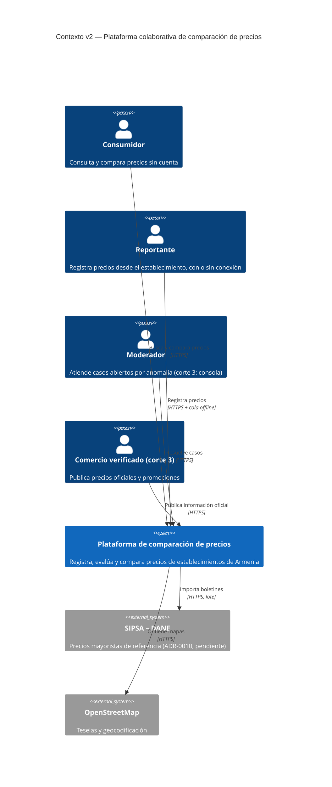
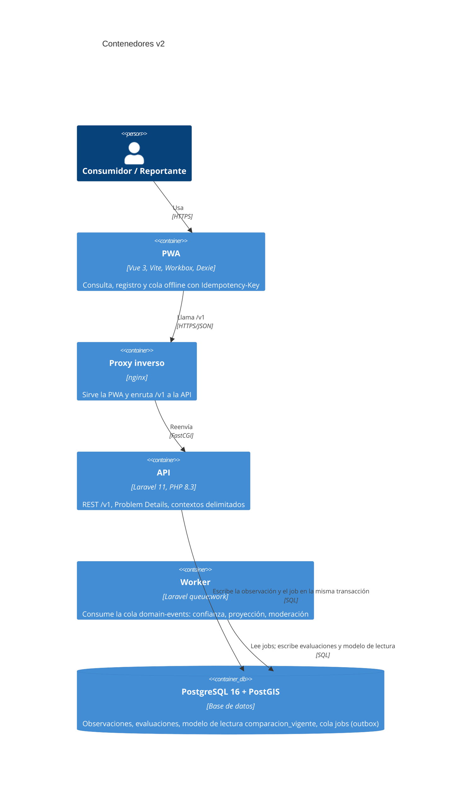
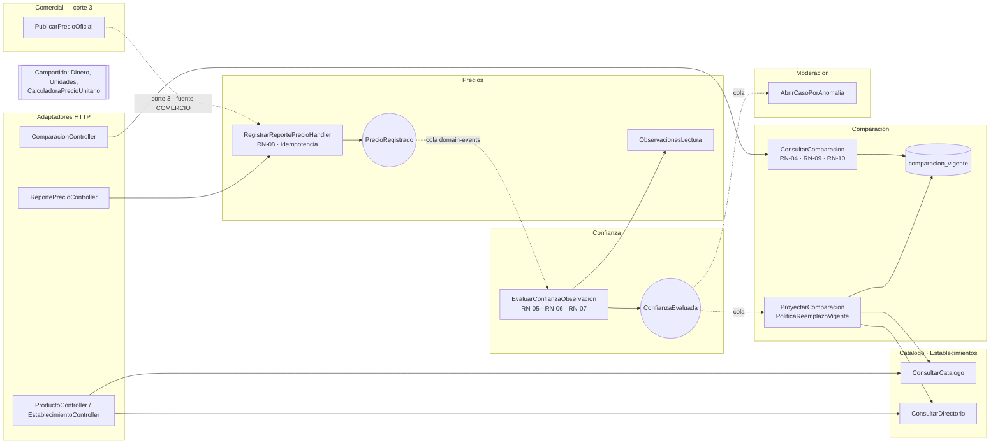

# Documento de arquitectura v2 — Núcleo implementado y extensión comercial

> Corte 2 · Arquitectura de Software II · Entregable 4. Fecha: 2026-11-16.
> Actualiza el [documento v1](documento-arquitectura-v1.md) con lo que realmente se construyó en el corte 2 y con
> los cambios que introduce el módulo comercial (corte 3), según el
> [análisis de impacto](analisis-impacto-modulo-comercial.md). Lo que no cambia respecto a v1 (contexto del
> problema, escenarios EC-01 a EC-10, comparación de alternativas A/B/C) no se repite.

## 1. Qué cambió desde la v1

| # | Cambio | Motivo | Decisión |
|---|---|---|---|
| 1 | Las reglas RN-04 a RN-07 y RN-09 se trasladaron de `Precios` a `Confianza`; RN-10 a `Comparacion`; dinero y unidades a un núcleo compartido (`Compartido`) | El código había divergido del diseño DDD de la v1 §3 | [ADR-0016](adr/0016-nucleo-compartido-y-fronteras-por-contexto.md) |
| 2 | Fronteras entre contextos verificadas por Deptrac (`backend/deptrac.yaml`), además de las capas | AR-01 y AR-02 no se verificaban | ADR-0016 |
| 3 | Flujo asíncrono de dos eventos: `PrecioRegistrado` → `ConfianzaEvaluada` | Separar quién evalúa (Confianza) de quién proyecta (Comparación) y de quién modera (Moderación) | [ADR-0003](adr/0003-cqrs-ligero-outbox.md) (sin cambio de decisión, se concreta) |
| 4 | Estado de confianza `NO_CORROBORADO` para un reporte único sin anomalías | La v1 solo tenía CONFIABLE / POR_VERIFICAR / NO_CONFIABLE; un único reporte normal no es «por verificar» | Contrato 0.2.0 |
| 5 | Identidad diferida: seudónimo HMAC interno hasta que exista el contexto Identidad | Priorizar el núcleo de extremo a extremo | [ADR-0014](adr/0014-contexto-comercial-e-identidad-diferida.md) |
| 6 | Contexto `Comercial` como módulo nuevo; el precio oficial es una observación más con fuente `COMERCIO` | Preparar el corte 3 sin cambios estructurales (EC-05) | ADR-0014, [ADR-0015](adr/0015-precio-oficial-frente-a-precio-reportado.md) |
| 7 | Contrato «primero»: Scramble no se adoptó | El contrato se escribe antes del código y lo verifican Spectral y las pruebas Feature | Nota de revisión en [ADR-0012](adr/0012-stack-tecnologico.md) |
| 8 | Cola offline con Dexie en la PWA | EC-09 estaba declarado pero sin implementar | [ADR-0006](adr/0006-pwa-offline-first.md) |

## 2. C4 nivel 1 — Contexto (v2)

El servicio de correo de la v1 sale del diagrama del corte 2: no habrá verificación de cuentas hasta Identidad (ADR-0014).

## 3. C4 nivel 2 — Contenedores (v2)

## 4. C4 nivel 3 — Componentes de la API (v2, implementado)

Reglas que Deptrac hace cumplir (extracto de `backend/deptrac.yaml`):

| Contexto | Puede depender de |
|---|---|
| Compartido | — |
| Precios | Compartido, Catálogo |
| Confianza | Compartido, Precios |
| Comparación | Compartido, Confianza, Catálogo, Establecimientos (**no Comercial**: AR-02) |
| Moderación | Compartido, Confianza |
| Comercial (corte 3) | Compartido, Catálogo, Establecimientos, Precios — ningún contexto puede depender de él |

## 5. Flujo de extremo a extremo (implementado y probado)

1. La PWA guarda el reporte en IndexedDB con una `Idempotency-Key` y lo envía (`POST /v1/reportes-precio`).
   Sin red, lo reintenta al volver la conexión con la misma clave (EC-09).
2. La API valida, aplica RN-08 (30/h; reemplazo del mismo día) y guarda la observación y el job en una
   transacción (outbox). Responde `202 PENDIENTE_EVALUACION`.
3. El worker evalúa la confianza: anomalía MAD con n ≥ 5 o historial ±50 % (RN-06), corroboración de
   reportantes independientes en 48 h (RN-05) y reputación (RN-07). Publica `ConfianzaEvaluada`.
4. Comparación decide con `PoliticaReemplazoVigente` si el nuevo precio reemplaza el publicado y actualiza
   `comparacion_vigente`. Si quedó POR_VERIFICAR, Moderación abre un caso.
5. `GET /v1/comparaciones` lee solo el modelo de lectura, aplica la vigencia (RN-04) y el orden neutral
   (RN-10) y declara `criterioOrden`.

Evidencia: `backend/tests/Feature/Api/V1/ComparacionTest.php` (21 pruebas del flujo completo, con el worker en
modo síncrono) y la semilla de demostración (`SemillaDemostracionSeeder`), que inserta los precios por el
mismo caso de uso.

## 6. Vista de despliegue (v2)

| Entorno | Cómo | Estado |
|---|---|---|
| Local | `docker compose up -d` + `make migrate seed` (api, worker, nginx, postgis, pwa) | Funciona |
| CI | GitHub Actions: Pest con cobertura ≥ 80 %, PHPStan 8, Deptrac (contextos y capas), Spectral, Vitest y build de la PWA | Configurado |
| Nube (ADR-0013) | Railway: servicios `api`, `worker` y `web` desde los mismos Dockerfile + PostgreSQL con PostGIS. Pasos en el README | **Pendiente de ejecutar por el equipo** (requiere la cuenta del equipo) |

## 7. Riesgos nuevos o actualizados

| Riesgo | Efecto | Mitigación |
|---|---|---|
| Seudónimo por IP (ADR-0014) | Redes compartidas mezclan reputación y límite de aportes | Identidad en el corte 3; mientras tanto, límite de 30/h es holgado |
| Latencia de la proyección (EC-02) | Si el worker se detiene, la comparación queda desactualizada | El worker es un servicio propio con reinicio automático; medir M-02 en el corte 3 (prueba I-02) |
| Núcleo compartido (ADR-0016) | Un cambio afecta a todos los contextos | Mantenerlo mínimo y cubierto por pruebas |
| Umbrales ⚑ sin evidencia de campo | Detección y vigencia pueden no ajustarse a la realidad | Fase 1 (entrevistas y encuesta) pendiente; ADR-0007 y ADR-0010 siguen en Propuesto |

## 8. Declaración de uso de inteligencia artificial generativa

Este documento y el código que describe se elaboraron con apoyo de Claude (Anthropic) como asistente de
programación y redacción. Las decisiones quedan registradas en los ADR citados y el equipo debe revisarlas,
poder explicarlas y defenderlas en la sustentación (guía §12.5).
