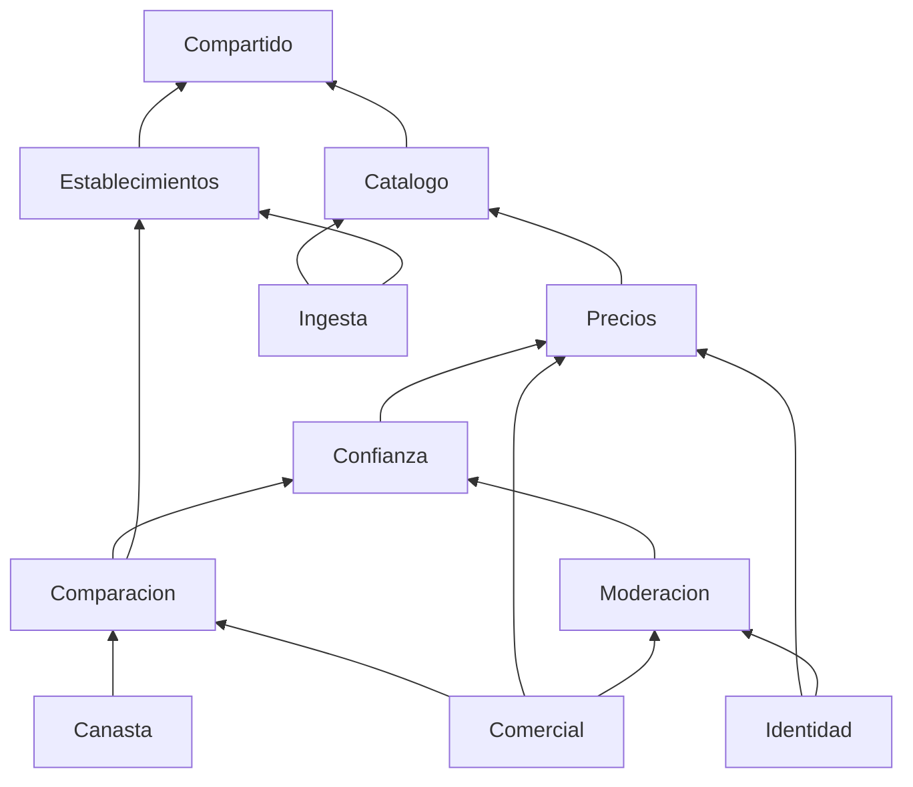
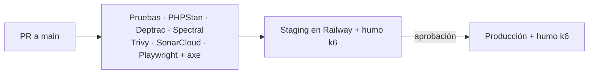

# Diseño, evolución y evaluación de la calidad de una plataforma colaborativa de comparación de precios en Armenia, Quindío

**Carlos Augusto Aranzazu Jinete · Miguel Ángel Rodríguez · Sofía Giraldo González**
Ingeniería de Software, Corporación Universitaria Empresarial Alexander von Humboldt · Seminario Nuclear 4 · II-2026
Asignaturas: Arquitectura de Software II y Modelos de Calidad · Docente: Rubén Darío Díaz Bautista

---

## Resumen

Este artículo presenta el diseño, la construcción, la evolución y la evaluación de **MercadoNorte**, una
plataforma web progresiva (PWA) en la que los consumidores de Armenia (Quindío) registran y comparan precios de
productos entre tiendas de barrio, supermercados y plazas de mercado. El reto central es que los precios son
**aportes colaborativos**: pueden ser viejos, erróneos o malintencionados, y la comparación debe ser neutral
frente a los intereses comerciales.

Se adoptó un **monolito modular** con once contextos delimitados, CQRS ligero con outbox transaccional y un
cliente *offline-first*. Las decisiones quedaron registradas en 26 ADR. La calidad se gestionó con
ISO/IEC 25010:2023, ISO/IEC 25012 y el proceso de evaluación de ISO/IEC 25040:2024, con 22 medidas y umbrales
propios.

Durante el semestre la arquitectura absorbió dos cambios de alcance sin modificaciones estructurales al núcleo:
- el módulo comercial (precio oficial y promociones);
- la ampliación del Anexo 1 (canasta comparada y entrega continua).

La evaluación final muestra un producto correcto, seguro, accesible y mantenible:
- 375 pruebas automatizadas y 99,6 % de cobertura del dominio;
- 0 violaciones de accesibilidad;
- 0 datos personales expuestos;
- precios reflejados en 1,35 s (p95).

Persiste una brecha de desempeño bajo 500 usuarios concurrentes, atribuida a una decisión de infraestructura
que no se registró como ADR.

**Palabras clave:** arquitectura de software, monolito modular, CQRS, ATAM, ISO/IEC 25010, ISO/IEC 25012,
ISO/IEC 25040, datos colaborativos, entrega continua.

## 1. Introducción

En Colombia, el precio de un mismo producto varía de forma importante entre establecimientos de una misma
ciudad. Las cadenas grandes publican catálogos en línea, pero las tiendas de barrio y las plazas, donde compra
buena parte de los hogares, no tienen presencia digital. El Sistema de Información de Precios del Sector
Agropecuario (SIPSA) del DANE publica precios **mayoristas** [8], que no son lo que paga el consumidor en la
tienda.

El proyecto responde a la guía del Proyecto Nuclear VI [1]: diseñar una plataforma colaborativa de comparación
de precios y **evaluar su calidad** a lo largo de tres cortes, incorporando un requerimiento de cambio (el módulo
comercial) y una ampliación (Anexo 1 [2]).

La motivación técnica es doble:
1. **Credibilidad de datos colaborativos.** Un precio aportado por un usuario anónimo no es confiable por
   defecto. La arquitectura debe evaluarlo antes de publicarlo sin bloquear el registro.
2. **Evolución bajo restricciones.** Un equipo de tres personas, durante un semestre y con nube gratuita (R-04),
   debía construir un sistema que aceptara cambios de alcance anunciados pero aún no especificados.

El resto del artículo se organiza así:
- **§2:** requisitos y escenarios.
- **§3:** decisiones arquitectónicas.
- **§4:** evolución por el módulo comercial.
- **§5:** la ampliación.
- **§6:** la evaluación de la calidad.
- **§7:** la evaluación de la arquitectura.
- **§8:** las conclusiones.

## 2. Requisitos y escenarios de calidad

Los requisitos se especificaron como funcionales (RF), no funcionales (RNF) y reglas de negocio (RN-01 a RN-16).
Los atributos de calidad se expresaron como **escenarios de seis partes** [3]. La Tabla 1 resume los que
guiaron la arquitectura, priorizados con un árbol de utilidad.

**Tabla 1.** Escenarios de calidad prioritarios y su medida de respuesta.

| Id | Atributo (norma) | Estímulo | Medida de respuesta |
|---|---|---|---|
| EC-01 | Capacidad de interacción (25010) | Registrar un precio frente a la góndola con red 3G | ≥ 80 % de los intentos en ≤ 15 s |
| EC-02 | Actualidad (25012) | Cambia el precio de un producto | La comparación lo refleja en ≤ 5 min |
| EC-03 | Credibilidad (25012), resistencia (25010) | Reportes falsos coordinados | Exhaustividad ≥ 80 %, falsos positivos ≤ 5 % |
| EC-04 | Eficiencia de desempeño (25010) | 500 usuarios concurrentes consultan | p95 ≤ 2 s, errores < 1 % |
| EC-05 | Modificabilidad (25010) | Incorporar el módulo comercial | 0 cambios estructurales al núcleo; real/estimado ≤ 1,3 |
| EC-06 | Corrección funcional (25010) | Un comercio publica una promoción | El orden responde solo al criterio declarado |
| EC-09 | Tolerancia a fallos (25010) | Registrar 3 precios sin conexión | 100 % sincronizados, 0 duplicados |
| EC-11 | Desempeño (ampliación A1) | 200 usuarios consultan canastas de 20 productos | p95 ≤ 3 s; faltantes señalados, nunca sumados |
| EC-12 | Capacidad de ser probado (ampliación B2) | Llega a `main` un cambio defectuoso o vulnerable | El pipeline lo bloquea antes de producción |

## 3. Decisiones arquitectónicas

### 3.1 Estilo: monolito modular frente a microservicios y BaaS

Se compararon tres alternativas con una matriz ponderada frente a los escenarios: monolito modular (A),
microservicios (B) y *backend* como servicio (C). A obtuvo 23 puntos, B 14 y C 3 [ADR-0002].

Los microservicios aportaban escalado independiente, pero su costo operacional (orquestación, observabilidad
distribuida, transacciones entre servicios) era inviable para tres personas (R-04). El BaaS dejaba sin
arquitectura propia que evaluar y ponía datos personales en un proveedor externo (R-01).

La modularidad del monolito se hace **verificable**: Deptrac comprueba en cada PR que cada contexto use solo la
interfaz pública de los contextos permitidos (Figura 1).

**Figura 1.** Contextos delimitados y dirección de las dependencias verificadas por Deptrac.

### 3.2 CQRS ligero con outbox transaccional

Registrar un precio y consultar una comparación tienen exigencias opuestas. El registro requiere consistencia
e idempotencia; la consulta, velocidad (EC-04). Se separaron con un **modelo de lectura** desnormalizado
(`comparacion_vigente`), alimentado por eventos de dominio [ADR-0003].

El evento se guarda en la misma transacción que la observación (*outbox*). Un *worker* lo procesa: Confianza
evalúa, la proyección actualiza el modelo de lectura y, si el precio es dudoso, Moderación abre un caso.

Se descartaron Event Sourcing y Saga porque ningún escenario los exigía [5].

### 3.3 Confianza como contexto propio

La credibilidad (EC-03) se resolvió con tres reglas aisladas en un contexto [ADR-0007]:
- **Detección de anomalías** con la desviación absoluta mediana (MAD, umbral 3,5 cuando hay ≥ 5 precios).
- **Corroboración:** dos reportantes distintos, ±5 %, dentro de 48 h.
- **Reputación** del reportante.

La observación se guarda siempre (trazabilidad); lo que cambia es su **publicación**.

### 3.4 Neutralidad por construcción

La comparación ordena solo por el criterio declarado (precio por unidad o distancia) y lo devuelve en cada
respuesta (`criterioOrden`) [ADR-0009]. La neutralidad no depende solo de pruebas: **la dirección de las
dependencias impide que Comparación lea datos comerciales** (prueba AR-02).

### 3.5 Cliente offline-first y paradigma de comunicación

La PWA guarda cada registro en IndexedDB con una clave de idempotencia y lo sincroniza al volver la red, con
reintento exponencial [ADR-0006]. Así el registro no depende de la latencia de la red (EC-01, EC-09).

La API es REST, documentada con OpenAPI 3.1 [ADR-0004]. GraphQL se estudió y se descartó: sus ventajas en
consultas flexibles no compensaban perder la caché HTTP en un cliente con un solo patrón de consulta. gRPC y
WebSockets no tenían caso de uso en el núcleo.

## 4. Evolución: el módulo comercial

El requerimiento de cambio introdujo comercios verificados que publican su **precio oficial** y
**promociones**. Las dos decisiones clave (Tabla 2) preservaron la neutralidad y el núcleo.

**Tabla 2.** Decisiones del módulo comercial.

| Decisión | Alternativa descartada | Razón |
|---|---|---|
| El precio oficial es **una observación más** (fuente `COMERCIO`), por el mismo flujo de confianza [ADR-0015] | Un flujo y una proyección propios con prioridad sobre el reportado | Duplicaba la lógica y daba trato preferente a quien tiene recursos para verificarse (equidad, guía §12) |
| Las promociones llegan a Comparación por un **puerto** (`PromocionesVigentes`) que define Comparación e implementa Comercial [ADR-0023] | Que Comparación consulte las tablas de Comercial | Violaba AR-02; el bloque `contenidoPromocional` ya estaba reservado desde el corte 1 |

**Resultado (M-07):** el PR del módulo (65 archivos, +2.727 líneas) modificó **un solo archivo del núcleo**, en
el punto de extensión previsto: un parámetro con valor por defecto y una línea. No hubo cambios estructurales.

## 5. La ampliación del corte 3 (Anexo 1)

El equipo eligió **A1 (canasta comparada)** del bloque funcional y **B2 (entrega continua con controles de
calidad)** del bloque de proceso.

### 5.1 Decisión más relevante: canasta calculada en consulta, sin persistencia en el servidor

La decisión arquitectónica más relevante de la ampliación fue **dónde vive la canasta y cuándo se calcula**
[ADR-0017, ADR-0018].

- **Alternativa descartada:** persistir canastas en el servidor y precalcular totales. Exigía invalidar cálculos
  con cada precio nuevo y guardaba hábitos de compra asociables a una persona (R-01).
- **Alternativa elegida:** el contexto **Canasta** recibe hasta 20 productos y calcula el total por establecimiento
  en una sola consulta, sobre la interfaz pública de Comparación. La canasta se guarda en el dispositivo.
- **Regla de negocio (RN-11 a RN-13, desarrolladas con TDD en U-11 a U-13):** los productos sin precio vigente **se señalan y
  nunca se suman como cero**.

**Evaluación:**
- **Corrección:** M-17 = 1, es decir, 5.264 de 5.264 respuestas correctas bajo carga.
- **Modificabilidad:** 0 cambios estructurales; un archivo nuevo en el núcleo.
- **Desempeño:** se corrigió una consulta N+1 que llevaba el p95 a 25,2 s. Después de la corrección, el p95 bajo
  200 usuarios es de 8,4 s, frente a una meta de 3 s.

Es el trade-off TO-3 (Tabla 4): actualidad y privacidad a cambio de latencia. Se mantiene, porque la causa
residual es el servidor de aplicaciones (§7).

### 5.2 Entrega continua (B2)

Cada fusión a `main` recorre un pipeline definido como código (Figura 2). Allí se integra el CI y se agregan
Trivy, SonarCloud y las pruebas de sistema y accesibilidad contra las mismas imágenes que se despliegan.
Después, el despliegue a staging con prueba de humo k6 y la promoción a producción con aprobación humana
[ADR-0020, ADR-0021].

**Figura 2.** Pipeline de entrega continua.

Para medir M-18 se abrieron dos PR con defectos deliberados: una regla de negocio alterada y una imagen con
vulnerabilidades críticas. **Los dos fueron bloqueados (2/2).** La mediana desde la fusión hasta staging fue de
4 min 48 s.

## 6. Evaluación de la calidad (ISO/IEC 25040 y 25012)

La evaluación siguió las cinco actividades de ISO/IEC 25040:2024: definir, diseñar, planificar, ejecutar y
concluir. Todas las mediciones son reproducibles desde el repositorio. La Tabla 3 resume los resultados.

**Tabla 3.** Resultados de la evaluación frente a los umbrales (sistema en `f4c84a7`, 2026-11-25).

| Característica | Medida | Resultado | Umbral | |
|---|---|---|---|---|
| Actualidad | M-02 | p95 1,35 s | ≤ 5 min | ✅ |
| Credibilidad | M-03 / M-04 (peor de 5 semillas) | 0,86 / 0,075 | ≥ 0,80 / ≤ 0,05 | ✅ / ❌ |
| Desempeño | M-05 / M-06 (500 usuarios) | p95 26,4 s / 12,9 % | ≤ 2 s / < 1 % | ❌ |
| Desempeño (canasta) | M-16 | p95 8,4 s | ≤ 3 s | ❌ |
| Interacción | M-01 | 62,5 % | ≥ 80 % | ❌ |
| Accesibilidad | M-11 | 0 violaciones A/AA | 0 | ✅ |
| Confidencialidad | M-10 | 0 campos personales | 0 | ✅ |
| Neutralidad | M-09 | 1 | 1 | ✅ |
| Fiabilidad offline | M-12 | 3/3, 0 duplicados | 1 | ✅ |
| Capacidad de ser probado | M-13 | 99,6 % del dominio (91,6 % total) | ≥ 80 % | ✅ |
| Modificabilidad | M-07 | 0 | 0 | ✅ |
| Entrega continua | M-18 / M-20 | 2/2 / 0 CVE críticas | 1 / 0 | ✅ |

De 22 medidas, 13 cumplen, 1 cumple con reservas, 5 no cumplen y 3 no se pudieron medir. Las tres sin medir son:
- el esfuerzo real (M-08);
- el tiempo de reversión (M-21);
- el precio oficial (M-22), porque aún no hay comercios reales.

**Calidad de los datos (ISO/IEC 25012).** Sobre 126 productos y 737 observaciones se midió:
- **Actualidad:** 0 precios vencidos mostrados como vigentes.
- **Completitud:** 100 %.
- **Trazabilidad:** 100 %.
- **Consistencia:** 0 duplicados, incluso después de cargar el catálogo SIPSA.
- **Confidencialidad:** 0 columnas con datos personales.

La auditoría de confidencialidad encontró que el *framework* guardaba la IP y el navegador en la tabla de
sesiones. Se corrigió: es un ejemplo de por qué la privacidad por diseño requiere auditar el esquema y no solo
las respuestas.

Se registraron 18 incidencias con su tratamiento. Seis llegaron a `main`, a producción o al pipeline. Cinco de
esas seis las detectaron mediciones, auditorías u operación, y no las pruebas funcionales.

## 7. Evaluación de la arquitectura

Se aplicó una versión reducida de ATAM [3]. La Tabla 4 presenta los principales trade-offs.

**Tabla 4.** Trade-offs identificados.

| Id | Se gana | Se cede |
|---|---|---|
| TO-1 | Exhaustividad de detección (M-03) | Falsos positivos (M-04) |
| TO-2 | Neutralidad y un solo flujo (precio oficial como observación) | Inmediatez para el comercio |
| TO-3 | Actualidad y privacidad (canasta calculada en consulta) | Latencia |
| TO-4 | Control humano antes de producción | Tiempo de entrega |
| TO-5 | Simplicidad operativa del monolito modular | Escalado independiente por contexto |

**El hallazgo principal es un riesgo que no está en el estilo arquitectónico.** Con 20 usuarios, el p95 de
consulta era de 162 ms, así que el modelo de lectura no es el límite. Con 500 usuarios, el servidor de
desarrollo de PHP (`artisan serve`), usado en la imagen de producción, se satura.

Esa decisión **nunca se registró como ADR** ni se contrastó con EC-04. Las decisiones de dominio se evaluaron
con rigor; las de operación entraron por defecto. El tratamiento es un cambio de infraestructura que no toca los
contextos: php-fpm o FrankenPHP.

**Respuesta al cambio (EC-05).** Los dos cambios de alcance tuvieron **0 cambios estructurales** en el núcleo.
La estimación fue de 43 h para el módulo comercial y de 71,5 h para la ampliación. El esfuerzo real está
pendiente del registro de horas del equipo. El historial de Git no sirve como sustituto, porque el trabajo
asistido por IA se concentró en una sola jornada. La reestimación del módulo comercial antes de empezar (+16 %)
mostró que el error de estimación provenía del diseño todavía abierto, no de la implementación.

## 8. Conclusiones

1. **La modificabilidad se puede diseñar y verificar.** Puntos de extensión previstos desde el corte 1 y
   fronteras comprobadas en cada PR permitieron absorber dos cambios de alcance sin tocar la estructura del
   núcleo.
2. **La credibilidad de datos colaborativos es un problema de arquitectura, no solo de algoritmo.** Separar
   «guardar» de «publicar», con evaluación asíncrona y moderación, permitió cambiar las reglas sin riesgo. Sus
   umbrales necesitan, de todas formas, datos de campo.
3. **La neutralidad es más robusta en la estructura que en las pruebas.** Una dependencia prohibida falla en el
   CI antes de que exista el defecto.
4. **Las decisiones de infraestructura merecen el mismo rigor que las de dominio.** La única brecha grave de
   calidad vino de una decisión operativa no registrada.
5. **En el proceso, lo automatizado se cumplió y lo humano no.** La entrega continua elevó el piso de calidad
   de forma medible (M-18 = 2/2). La revisión por pares, el registro de esfuerzo y la distribución del trabajo
   quedaron como las principales mejoras pendientes.

## Referencias

1. Corporación Universitaria Empresarial Alexander von Humboldt. (2026). *Guía del Proyecto Nuclear VI, II-2026*. Programa de Ingeniería de Software.
2. Corporación Universitaria Empresarial Alexander von Humboldt. (2026). *Anexo 1: Ampliación del corte 3*. Programa de Ingeniería de Software.
3. Bass, L., Clements, P., & Kazman, R. (2021). *Software architecture in practice* (4th ed.). Addison-Wesley Professional.
4. Richards, M., & Ford, N. (2020). *Fundamentals of software architecture: An engineering approach*. O'Reilly Media.
5. Kleppmann, M. (2017). *Designing data-intensive applications*. O'Reilly Media.
6. ISO/IEC 25010:2023. *Systems and software engineering — SQuaRE — Product quality model*. ISO.
7. ISO/IEC 25040:2024. *Systems and software engineering — SQuaRE — Quality evaluation framework*. ISO.
8. Departamento Administrativo Nacional de Estadística. (2026). *Sistema de Información de Precios y Abastecimiento del Sector Agropecuario (SIPSA)*. DANE. https://www.dane.gov.co/index.php/estadisticas-por-tema/agropecuario/sistema-de-informacion-de-precios-sipsa
9. ISO/IEC 25012:2008. *Software engineering — SQuaRE — Data quality model*. ISO.
10. Nygard, M. (2011). *Documenting architecture decisions*. Cognitect.
11. Brown, S. (s. f.). *The C4 model for visualising software architecture*. https://c4model.com
12. CMMI Institute. (2023). *CMMI V3.0: Model at a glance*. CMMI Institute.

## Reconocimientos

Al docente Rubén Darío Díaz Bautista por la guía del proyecto, y al DANE por publicar los datos abiertos de
SIPSA.

**Declaración de uso de IA generativa (guía §12.5).** El código y los documentos se elaboraron con apoyo de
Claude (Anthropic) como asistente de programación y redacción. Las decisiones están registradas en los ADR, y
los autores deben poder explicarlas y defenderlas en la sustentación.

> Documentos de soporte: [arquitectura final](03-arquitectura/documento-arquitectura-final.md) ·
> [evaluación de la arquitectura](03-arquitectura/evaluacion-arquitectura.md) ·
> [evaluación de la calidad](02-calidad/informe-evaluacion-calidad.md) ·
> [calidad del proceso y plan de mejora](02-calidad/calidad-proceso-plan-mejora.md) · [ADRs](03-arquitectura/adr/)
